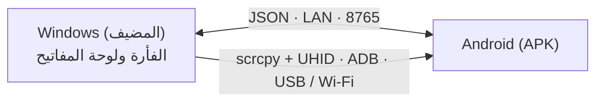

# EzAcrossControl


**اتصل. تحكّم. واصل.** · by ElementZero

اقرأ بلغة: [Português](../../README.md) · [English](README.en.md) · [Español](README.es.md) · [日本語](README.ja.md) · [Italiano](README.it.md) · [Français](README.fr.md) · [Deutsch](README.de.md) · [简体中文](README.zh-CN.md) · [Tiếng Việt](README.vi.md) · [한국어](README.ko.md) · **[العربية](README.ar.md)**

🌐 **الموقع:** [eddesignerez.github.io/EzAcrossControl](https://eddesignerez.github.io/EzAcrossControl/) · ⬇️ **الإصدار الحالي:** [1.1.27](https://github.com/eddesignerez/EzAcrossControl/releases/tag/v1.1.27)

استخدم فأرة ولوحة مفاتيح حاسوب Windows للتحكم في جهاز لوحي أو هاتف Android كأنه شاشة ثانية. حرّك المؤشر إلى حافة الشاشة التي اخترتها فينتقل التحكم إلى Android، ثم اعبر الحافة نفسها عائدًا (أو اضغط **Esc**) فيعود التحكم إلى Windows. يجري كل شيء داخل شبكتك المحلية، دون حساب أو تسجيل ودون خدمات سحابية.

## لمن هذا التطبيق

- لمن يضع جهازًا لوحيًا بنظام Android بجوار الحاسوب ويريد فأرة ولوحة مفاتيح واحدة للجهازين.
- لمن يريد الكتابة على الهاتف بلوحة مفاتيح فعلية، أو الرد على الرسائل، أو استخدام تطبيقات Android دون مغادرة المكتب.
- لمن يفضّل حلًا محليًا لا يرسل البيانات إلى خوادم جهات خارجية.

## الميزات

| الميزة | طريقة العمل |
| --- | --- |
| **التبديل عبر الحافة** | اختر ما إذا كان Android على يسار الشاشة أو يمينها. يعبر المؤشر الحافة فيبدأ التحكم في Android. |
| **فأرة ولوحة مفاتيح أصلية** | يدمج محرك التحكم [scrcpy](https://github.com/Genymobile/scrcpy) مع UHID، فيرى Android فأرة ولوحة مفاتيح فعليتين مع التمرير والنقر والاختصارات. |
| **USB أو Wi‑Fi** | اتصل بالكابل أو عبر تصحيح الأخطاء اللاسلكي. في الوضع **تلقائي** تكون الأولوية لـ USB، ويتولى Wi‑Fi الاتصال عند عدم توفر الكابل. |
| **الشبكة المحلية فقط** | يتواصل Windows وAndroid مباشرة عبر الشبكة المحلية (المنفذ الافتراضي **8765** وقابل للتغيير). لا يوجد خادم وسيط. |
| **مثبّت متكامل** | يتضمن مثبّت Windows ‏.NET وADB ومحرك التحكم. لا حاجة لتثبيت SDK أو أدوات تطوير. |
| **تحديثات آمنة** | يتحقق التطبيقان من أحدث إصدار مستقر على GitHub ويعرضان التحديث، ولا يتم التنزيل إلا بموافقتك مع التحقق من SHA‑256. |
| **منطقة الإعلامات والتشغيل التلقائي** | يبقى تطبيق Windows في منطقة الإعلامات ويمكن تشغيله مع بدء Windows (اختياري). |
| **11 لغة وسمتان** | واجهة بـ 11 لغة مع سمة فاتحة أو داكنة أو حسب النظام. |

## كيف يعمل



1. يلتقط تطبيق Windows الفأرة ولوحة المفاتيح ويراقب الحافة المختارة.
2. عندما يعبر المؤشر الحافة، ينقل المحرك الأصلي (scrcpy + UHID) التحكم إلى Android عبر USB أو Wi‑Fi.
3. يعرض تطبيق Android حالة الاتصال ويعيد التحكم عندما يعود المؤشر عبر الحافة.
4. يتبادل التطبيقان الرسائل وفق عقد JSON الموجود في [Protocol/protocol.md](../../Protocol/protocol.md).

## التنزيل والتثبيت

- [مثبّت Windows ‏1.1.27 (‎.exe)](https://github.com/eddesignerez/EzAcrossControl/releases/download/v1.1.27/EZAcrossControl-1.1.27-windows-x64-setup.exe)
- [تطبيق Android ‏1.1.27 (‎.apk)](https://github.com/eddesignerez/EzAcrossControl/releases/download/v1.1.27/EZAcrossControl-1.1.27-android.apk)
- [نسخة Windows المحمولة 1.1.18 (‎.zip)](https://github.com/eddesignerez/EzAcrossControl/releases/download/v1.1.18/EZAcrossControl-1.1.18-windows-x64-portable.zip) — آخر إصدار نُشر بصيغة محمولة
- [جميع الإصدارات ومصادر الجهات الخارجية وفحوص السلامة (SHA‑256)](https://github.com/eddesignerez/EzAcrossControl/releases)

### المتطلبات

| العنصر | المطلوب |
| --- | --- |
| **Windows** | Windows 10 أو 11 بنظام 64 بت. يتضمن المثبّت ‎.NET وADB ومحرك التحكم. |
| **Android** | Android 7 أو أحدث. يعتمد التحكم الأصلي على دعم الجهاز لـ UHID، وقد تتطلب بعض تطبيقات الشركات المصنّعة إعدادات إضافية. |
| **الشبكة** | Windows وAndroid على الشبكة المحلية نفسها، حتى عند اختيار USB لمحرك التحكم. |
| **تصحيح الأخطاء** | تصحيح أخطاء USB مسموح به، أو تصحيح أخطاء لاسلكي مفعّل ومقترن. يتطلب التصحيح اللاسلكي من قائمة Android الإصدار 11 أو أحدث. |

### الاستخدام الأول

1. شغّل مثبّت Windows وافتح **EzAcrossControl**. يطلب التثبيت صلاحيات المسؤول لإعداد الخادم المحلي وجدار الحماية للشبكة الخاصة.
2. ثبّت ملف APK على Android. إذا طلب النظام ذلك، اسمح بالتثبيت من التطبيق الذي فتحت به الملف.
3. من **الوضع المتقدم ← تصحيح الأخطاء ← فتح الإعدادات** فعّل خيارات المطوّر وطريقة تصحيح الأخطاء المطلوبة. اسمح للحاسوب عندما يسألك Android.
4. لاستخدام Wi‑Fi، افتح **تصحيح الأخطاء اللاسلكي ← إقران الجهاز باستخدام رمز إقران**. على الحاسوب، شغّل ADB المرفق مع التطبيق:

   ```powershell
   & "$env:ProgramFiles\EZ Across Control\scrcpy\adb.exe" pair <Android-IP>:<pairing-port>
   ```

   أدخل الرمز الذي يعرضه Android. منفذ الإقران يختلف عن منفذ الاتصال. إذا لم يعثر الاكتشاف التلقائي على الجهاز، فاستخدم `adb connect <Android-IP>:<connection-port>`.

5. في التطبيق، اختر **وضع الاتصال**: **تلقائي** أو **Wi‑Fi** أو **USB** (انظر الجدول أدناه).
6. في **الكمبيوتر المضيف** أدخل عنوان IP الظاهر في Windows والمنفذ نفسه في التطبيقين. المنفذ الافتراضي هو **8765**.
7. اضغط الدائرة **اتصال**. يخبرك التطبيق عندما يصبح التحكم متاحًا عبر Wi‑Fi أو USB. اختر موضع Android في Windows ثم حرّك المؤشر إلى تلك الحافة لتبديل التحكم.

### أوضاع الاتصال

اختر الوضع في Windows وفي Android، ويجب أن يتوافق الطرفان:

| Windows ↓ / Android → | تلقائي | Wi‑Fi | USB |
| --- | --- | --- | --- |
| **تلقائي** | USB، وإلا Wi‑Fi | Wi‑Fi | USB |
| **Wi‑Fi** | Wi‑Fi | Wi‑Fi | ❌ محظور |
| **USB** | USB | ❌ محظور | USB |

إذا كان طرف واحد فقط في وضع يدوي، يُستخدم ذلك الوضع. اختلاف الوضعين اليدويين يمنع الاتصال؛ وحّد الاختيار أو اختر تلقائي. الوضع اليدوي USB لا ينتقل إلى Wi‑Fi. تحتفظ القوائم باختياراتك، ويعرض حقل النقل الاتصال النشط.

## التحكم ولوحة المفاتيح والإعدادات

- **تبديل الشاشة:** حرّك المؤشر إلى الحافة المختارة. للعودة إلى Windows، اعبر الحافة نفسها في الاتجاه المعاكس أو اضغط **Esc**.
- **إمكانية الوصول** تساعد في التحكم عن بعد والعودة عبر الحافة. يفعّلها المستخدم من قائمة Android.
- **لوحة مفاتيح عن بعد** توضّح ما إذا كانت لوحة المفاتيح المساعدة مفعّلة ومختارة. يستخدم المحرك الأصلي أيضًا لوحة مفاتيح HID؛ اضبط لغتها وتخطيطها من خيارات لوحة المفاتيح الفعلية في Android عند الحاجة.
- **إيقاف التحكم** يحرر التحكم عن بعد ويغلق اتصال التطبيق. اضغط اتصال مجددًا لبدء جلسة أخرى.
- زر **X** في Windows ينقل التطبيق إلى منطقة الإعلامات. استخدم **استعادة** لإعادة فتحه و**خروج** لإغلاقه.
- **بدء التشغيل مع Windows** (أسفل اللغة) يفتح التطبيق عند تسجيل الدخول إلى Windows. الخيار اختياري، ويخص المستخدم الحالي فقط، ويُزال عند إلغاء تحديده.
- أيقونتا الشمس والقمر تبدّلان السمة. يوجد **التشخيص** و**سجل النشاط** في الوضع المتقدم.

## التحديثات

عند الفتح، يتحقق Windows وAndroid من أحدث إصدار مستقر منشور في هذا المستودع. تختار **تحديث الآن** أو **لاحقًا**، ولا يُنزَّل أو يُثبَّت أي شيء دون موافقتك. يجب أن تطابق الحزمة الاسم والإصدار والعنوان تمامًا، وأن يكون حجمها محدودًا، وأن تطابق قيمة SHA‑256 التي يوفرها GitHub. في Windows يحتفظ المثبّت بالإعدادات ويعيد فتح التطبيق عند الانتهاء. دون إنترنت يفشل التحقق فقط دون التأثير في التحكم عبر الشبكة المحلية. التفاصيل (بالبرتغالية) في [Docs/automatic-updates.md](../automatic-updates.md).

## الخصوصية والشبكة

- يبقى التحكم والرسائل بين الجهازين داخل الشبكة المحلية. لا حساب ولا قياس عن بعد ولا توجيه عبر السحابة.
- الاتصال الوحيد بالإنترنت هو التحقق الاختياري من التحديثات على GitHub.
- قاعدة جدار الحماية التي ينشئها المثبّت تسمح فقط باتصالات TCP على المنفذ المختار، في الشبكات الخاصة والشبكة الفرعية المحلية.

## اللغات

Português وEnglish وEspañol و日本語 وItaliano وFrançais وDeutsch و简体中文 وTiếng Việt و한국어 والعربية.

يتبع Android لغة النظام افتراضيًا. لتغييرها، افتح **الوضع المتقدم ← اللغة** أسفل تصحيح الأخطاء. في Windows يوجد محدد اللغة في قسم التشخيص. يُحفظ الاختيار محليًا.

## حل المشكلات

- **تصحيح الأخطاء معطّل أو الجهاز غير مصرّح له:** افتح الإعدادات التي يشير إليها التطبيق، وفعّل الخيار، واسمح للحاسوب.
- **انقطع Wi‑Fi:** تحقّق من تصحيح الأخطاء اللاسلكي والمنفذ الحالي؛ قد يغيّر Android المنفذ بعد إيقاف الخيار وتشغيله. يحدّث التطبيق توفر التحكم طالما كان مفتوحًا.
- **تعذّر الوصول إلى الخادم:** تأكد من عنوان IP والمنفذ ومن أن شبكة Windows مضبوطة على أنها خاصة. قاعدة المثبّت تسمح بالشبكة المحلية الخاصة فقط.
- **الاتصال محظور:** الوضعان اليدويان في Windows وAndroid مختلفان. اختر الوضع نفسه في الطرفين أو استخدم تلقائي.
- **منفذ غير 8765:** أوقف الخادم وغيّر المنفذ ثم شغّله مجددًا. يطلب التطبيق إذن Windows إذا احتاج إلى تعديل حجز URL أو قاعدة جدار الحماية. يُحفظ المنفذ بعد التشغيل الناجح؛ اضبط القيمة نفسها في Android. في الإصدار 1.1.0 تتطلب المنافذ المخصصة إعدادًا يدويًا.
- **ملف APK تجريبي قديم:** يستخدم إصدار التوزيع توقيعًا خاصًا به. للانتقال من APK تصحيح الأخطاء، أزل الإصدار القديم ثم ثبّت هذا الإصدار، وستحتاج إلى إدخال التفضيلات مجددًا.
- **نسخة Windows المحمولة:** شغّلها بصلاحيات المسؤول للاستماع على الشبكة المحلية، أو اضبط حجز URL وجدار الحماية. النسخة القابلة للتثبيت تضبط المنفذ الافتراضي تلقائيًا.
- **تحذير SmartScreen:** مثبّت Windows غير موقّع بـ Authenticode حتى الآن. تحقق من SHA‑256 في صفحة الإصدار قبل تشغيله.

أُجريت الاختبارات الفعلية على جهازي HiPadPlus وLAVIE T11. على HiPadPlus لم يُظهر Gboard الشريط المصغّر مجددًا إلا بعد إعادة ضبط الجهاز؛ وقد تعتمد النتيجة على حالة Android وإصدار Gboard. يجب التحقق من التوافق مع الشركات المصنّعة الأخرى على الجهاز المستخدم. ملف APK موقّع بتوقيع التوزيع.

## معاينات مرئية

هذه الصور **دراسات ثابتة للهوية البصرية** أُنشئت من الشعار المقدَّم، وليست لقطات شاشة للتطبيق أثناء التشغيل.

| مقترح Day | مقترح Night |
| --- | --- |
|  |  |

## البنية والتطوير

يستخدم مضيف WPF ‏(.NET 8) وعميل Kotlin/Compose عقد JSON الموجود في [Protocol/protocol.md](../../Protocol/protocol.md). يدمج المحرك الأصلي scrcpy مع تعديل لالتقاط الإدخال وإعادته. لا يوجد توجيه عبر السحابة. راجع أيضًا [Docs/architecture.md](../architecture.md) و[Docs/status.md](../status.md).

| المجلد | المحتوى |
| --- | --- |
| `Windows-host/` | مضيف Windows ومنطقة الإعلامات والالتقاط ومحرك التحكم |
| `Android-client/` | تطبيق APK وزر الاتصال الدائري وإمكانية الوصول ولوحة المفاتيح المساعدة |
| `Localization/` | الفهرس المشترك للغات الإحدى عشرة |
| `Protocol/` | عقد JSON بين التطبيقين |
| `Tests/` | اختبارات المضيف |
| `packaging/` | مثبّت Windows |
| `scripts/` | توليد اللغات والبناء ومصادر التوزيع |
| `patches/` | تعديلات scrcpy |
| `site/` | موقع المشروع المنشور على GitHub Pages |

متطلبات التطوير: ‎.NET 8 SDK وAndroid SDK وJDK 17 وNode.js لتوليد فهرس اللغات. لبناء المحرك راجع [Docs/v2/build-scrcpy-windows.md](../v2/build-scrcpy-windows.md).

```powershell
node scripts/build-localization.cjs
dotnet build Windows-host/WindowsHost.csproj
dotnet test Tests/WindowsHost.Tests/WindowsHost.Tests.csproj -c Release
cd Android-client
.\gradlew.bat :app:assembleDebug :app:testDebugUnitTest
```

ينشئ السكربتان `build-windows-release.ps1` و`build-android-release.ps1` حزم التوزيع. يحتاج APK الإصدار إلى مفتاح خاص؛ ويحتفظ السكربت بالمفتاح وكلمة المرور في المجلد المحلي المستثنى `.release-private`. احفظ هذا المجلد بأمان لتوقيع التحديثات المستقبلية. لا ترفع أبدًا المفاتيح أو التفضيلات الشخصية أو السجلات إلى GitHub.

توجد الترجمات في `Localization/messages.tsv`؛ شغّل المولّد بعد تعديلها. تستخدم المنصتان الفهرس دون تغيير قيم البروتوكول.

## الجهات الخارجية

راجع [THIRD-PARTY-NOTICES.md](../../THIRD-PARTY-NOTICES.md) والتراخيص المضمّنة في التثبيت وأرشيف المصادر الأصلية للإصدار. تحتفظ هذه المكونات بتراخيصها الخاصة.
