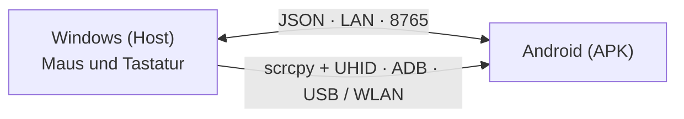

# EzAcrossControl


**Verbinden. Steuern. Weiterarbeiten.** · by ElementZero

Lesen auf: [Português](../../README.md) · [English](README.en.md) · [Español](README.es.md) · [日本語](README.ja.md) · [Italiano](README.it.md) · [Français](README.fr.md) · **[Deutsch](README.de.md)** · [简体中文](README.zh-CN.md) · [Tiếng Việt](README.vi.md) · [한국어](README.ko.md) · [العربية](README.ar.md)

🌐 **Website:** [eddesignerez.github.io/EzAcrossControl](https://eddesignerez.github.io/EzAcrossControl/) · ⬇️ **Aktuelle Version:** [1.1.27](https://github.com/eddesignerez/EzAcrossControl/releases/tag/v1.1.27)

Steuern Sie ein Android-Tablet oder -Smartphone mit Maus und Tastatur Ihres Windows-PCs, als wäre es ein zweiter Monitor. Bewegen Sie den Mauszeiger an den gewählten Bildschirmrand, und die Steuerung wechselt zu Android; über denselben Rand zurück (oder mit **Esc**) kehrt sie zu Windows zurück. Alles läuft in Ihrem lokalen Netzwerk – ohne Konto, ohne Registrierung und ohne Cloud-Dienste.

## Für wen

- Für alle, die ein Android-Tablet neben dem PC nutzen und eine Maus und eine Tastatur für beide Geräte möchten.
- Für alle, die auf dem Smartphone mit einer echten Tastatur schreiben, Nachrichten beantworten oder Android-Apps bedienen möchten, ohne den Schreibtisch zu verlassen.
- Für alle, die eine lokale Lösung bevorzugen, die keine Daten an Server Dritter sendet.

## Funktionen

| Funktion | So funktioniert es |
| --- | --- |
| **Wechsel am Bildschirmrand** | Wählen Sie, ob Android links oder rechts vom Monitor steht. Der Zeiger überquert den Rand und steuert dann Android. |
| **Native Maus und Tastatur** | Die Steuer-Engine integriert [scrcpy](https://github.com/Genymobile/scrcpy) mit UHID: Android erkennt eine echte Maus und Tastatur, mit Scrollen, Klicks und Tastenkombinationen. |
| **USB oder WLAN** | Verbindung per Kabel oder über kabelloses Debugging. Im Modus **Auto** hat USB Vorrang, und WLAN übernimmt, wenn kein Kabel verfügbar ist. |
| **Nur lokales Netzwerk** | Windows und Android kommunizieren direkt über das LAN (Standardport **8765**, konfigurierbar). Es gibt keinen Zwischenserver. |
| **Komplettes Installationsprogramm** | Das Windows-Installationsprogramm enthält bereits .NET, ADB und die Steuer-Engine. Kein SDK und keine Entwicklerwerkzeuge nötig. |
| **Sichere Updates** | Beide Apps prüfen die neueste stabile Version auf GitHub, bieten das Update an und laden es nur mit Ihrer Zustimmung herunter – mit SHA‑256-Prüfung. |
| **Infobereich und Autostart** | Die Windows-App läuft im Infobereich und kann optional mit Windows starten. |
| **11 Sprachen, zwei Designs** | Oberfläche in 11 Sprachen, mit hellem, dunklem oder systemabhängigem Design. |

## So funktioniert es



1. Die Windows-App erfasst Maus und Tastatur und überwacht den gewählten Rand.
2. Überquert der Zeiger den Rand, übergibt die native Engine (scrcpy + UHID) die Steuerung per USB oder WLAN an Android.
3. Die Android-App zeigt den Verbindungsstatus und gibt die Steuerung zurück, wenn der Zeiger wieder über den Rand geht.
4. Beide Apps tauschen Nachrichten über den JSON-Vertrag in [Protocol/protocol.md](../../Protocol/protocol.md) aus.

## Herunterladen und installieren

- [Windows-Installationsprogramm 1.1.27 (.exe)](https://github.com/eddesignerez/EzAcrossControl/releases/download/v1.1.27/EZAcrossControl-1.1.27-windows-x64-setup.exe)
- [Android-App 1.1.27 (.apk)](https://github.com/eddesignerez/EzAcrossControl/releases/download/v1.1.27/EZAcrossControl-1.1.27-android.apk)
- [Windows portabel 1.1.18 (.zip)](https://github.com/eddesignerez/EzAcrossControl/releases/download/v1.1.18/EZAcrossControl-1.1.18-windows-x64-portable.zip) – letzte als portable Version veröffentlichte Ausgabe
- [Alle Versionen, Drittanbieter-Quellen und Integritätsprüfungen (SHA‑256)](https://github.com/eddesignerez/EzAcrossControl/releases)

### Voraussetzungen

| Bereich | Erforderlich |
| --- | --- |
| **Windows** | Windows 10 oder 11, 64 Bit. Das Installationsprogramm enthält .NET, ADB und die Steuer-Engine. |
| **Android** | Android 7 oder neuer. Die native Steuerung hängt von der UHID-Unterstützung des Geräts ab; manche Herstellerimplementierungen erfordern zusätzliche Einstellungen. |
| **Netzwerk** | Windows und Android im selben lokalen Netzwerk, auch wenn USB für die Steuer-Engine gewählt ist. |
| **Debugging** | Autorisiertes USB-Debugging oder aktiviertes und gekoppeltes kabelloses Debugging. Kabelloses Debugging über das Android-Menü erfordert Android 11 oder neuer. |

### Erste Schritte

1. Führen Sie das Windows-Installationsprogramm aus und öffnen Sie **EzAcrossControl**. Die Installation fragt nach Administratorrechten, um den lokalen Server und die Firewall für private Netzwerke einzurichten.
2. Installieren Sie die APK auf Android. Erlauben Sie bei Nachfrage die Installation über die App, mit der Sie die Datei geöffnet haben.
3. Aktivieren Sie unter **Erweiterter Modus → Debugging → Einstellungen Öffnen** die Entwickleroptionen und die gewünschte Debugging-Methode. Erlauben Sie den Computer, wenn Android nachfragt.
4. Für WLAN öffnen Sie **Kabelloses Debugging → Gerät über einen Kopplungscode koppeln**. Führen Sie am Computer das mitgelieferte ADB aus:

   ```powershell
   & "$env:ProgramFiles\EZ Across Control\scrcpy\adb.exe" pair <Android-IP>:<Kopplungsport>
   ```

   Geben Sie den von Android angezeigten Code ein. Kopplungsport und Verbindungsport sind unterschiedlich. Findet die automatische Erkennung das Gerät nicht, verwenden Sie `adb connect <Android-IP>:<Verbindungsport>`.

5. Wählen Sie in der APK den **Verbindungsmodus**: **Auto**, **WLAN** oder **USB** (siehe Tabelle unten).
6. Geben Sie unter **Host-PC** die unter Windows angezeigte IP und in beiden Apps denselben Port ein. Der Standardport ist **8765**.
7. Tippen Sie auf den Kreis **Verbinden**. Die App meldet, wann die Steuerung per WLAN oder USB verfügbar ist. Wählen Sie in Windows die Position von Android und bewegen Sie den Zeiger an diesen Rand, um die Steuerung zu wechseln.

### Verbindungsmodi

Wählen Sie den Modus unter Windows und unter Android. Beide Seiten müssen zusammenpassen:

| Windows ↓ / Android → | Auto | WLAN | USB |
| --- | --- | --- | --- |
| **Auto** | USB; falls nicht verfügbar, WLAN | WLAN | USB |
| **WLAN** | WLAN | WLAN | ❌ Blockiert |
| **USB** | USB | ❌ Blockiert | USB |

Ist nur eine Seite auf einen manuellen Modus gestellt, wird dieser verwendet. Unterschiedliche manuelle Modi blockieren die Verbindung; gleichen Sie die Auswahl an oder wählen Sie Auto. Der manuelle USB-Modus weicht nicht auf WLAN aus. Die Auswahlfelder behalten Ihre Einstellungen, und das Transportfeld zeigt die aktive Verbindung.

## Steuerung, Tastatur und Einstellungen

- **Bildschirm wechseln:** Bewegen Sie den Zeiger an den gewählten Rand. Zurück zu Windows geht es über denselben Rand in Gegenrichtung oder mit **Esc**.
- **Bedienungshilfen** unterstützen die Fernsteuerung und die Rückkehr über den Rand. Sie werden vom Benutzer im Android-Menü aktiviert.
- **Ferntastatur** zeigt an, ob die Hilfstastatur aktiviert und ausgewählt ist. Die native Engine verwendet außerdem eine HID-Tastatur; stellen Sie bei Bedarf Sprache/Layout in den Android-Optionen für physische Tastaturen ein.
- **Steuerung Stoppen** gibt die Fernsteuerung frei und beendet die APK-Verbindung. Tippen Sie erneut auf Verbinden, um eine neue Sitzung zu starten.
- Die Schaltfläche **X** unter Windows verschiebt die App in den Infobereich. Mit **Wiederherstellen** öffnen Sie sie wieder, mit **Beenden** schließen Sie sie.
- **Mit Windows starten** (unter der Sprache) öffnet die App bei der Windows-Anmeldung. Die Option ist freiwillig, gilt nur für den aktuellen Benutzer und wird beim Abwählen entfernt.
- Die Sonnen-/Mond-Symbole wechseln das Design. **Diagnose** und **Aktivitätsprotokoll** befinden sich im erweiterten Modus.

## Updates

Beim Öffnen prüfen Windows und Android die neueste stabile Version in diesem Repository. Sie wählen **Jetzt aktualisieren** oder **Später**; ohne Ihre Zustimmung wird nichts heruntergeladen oder installiert. Das Paket muss exakt Name, Version und Adresse, eine begrenzte Größe und den von GitHub gemeldeten SHA‑256 aufweisen. Unter Windows behält das Installationsprogramm die Einstellungen bei und öffnet die App danach wieder. Ohne Internet schlägt nur die Prüfung fehl; die Steuerung im lokalen Netzwerk ist nicht betroffen. Details (auf Portugiesisch) in [Docs/automatic-updates.md](../automatic-updates.md).

## Datenschutz und Netzwerk

- Steuerung und Nachrichten zwischen den Geräten bleiben im lokalen Netzwerk. Kein Konto, keine Telemetrie, kein Cloud-Routing.
- Die einzige Internetverbindung ist die optionale Update-Prüfung auf GitHub.
- Die vom Installationsprogramm erstellte Firewall-Regel erlaubt nur TCP auf dem gewählten Port, in privaten Netzwerken und im lokalen Subnetz.

## Sprachen

Português, English, Español, 日本語, Italiano, Français, Deutsch, 简体中文, Tiếng Việt, 한국어 und العربية.

Android folgt standardmäßig der Systemsprache. Zum Ändern öffnen Sie **Erweiterter Modus → Sprache** unterhalb des Debuggings. Unter Windows befindet sich die Auswahl im Diagnosebereich. Die Auswahl wird lokal gespeichert.

## Fehlerbehebung

- **Debugging aus oder Gerät nicht autorisiert:** Öffnen Sie die von der APK angezeigten Einstellungen, aktivieren Sie die Option und erlauben Sie den Computer.
- **WLAN-Verbindung abgebrochen:** Prüfen Sie das kabellose Debugging und den aktuellen Port; Android kann den Port nach dem Aus- und Einschalten der Option ändern. Die App aktualisiert die Verfügbarkeit der Steuerung, solange sie geöffnet ist.
- **Server nicht erreichbar:** Prüfen Sie IP, Port und ob das Windows-Netzwerk als privat eingestuft ist. Die Regel des Installationsprogramms erlaubt nur das private lokale Netzwerk.
- **Verbindung blockiert:** Die manuellen Modi von Windows und Android unterscheiden sich. Wählen Sie auf beiden Seiten denselben Modus oder Auto.
- **Anderer Port als 8765:** Stoppen Sie den Server, ändern Sie den Port und starten Sie ihn erneut. Die App fragt nach einer Windows-Berechtigung, wenn die URL-Reservierung oder Firewall-Regel angepasst werden muss. Der Port wird nach einem erfolgreichen Start gespeichert; tragen Sie denselben Wert in Android ein. In Version 1.1.0 erfordern benutzerdefinierte Ports eine manuelle Konfiguration.
- **Ältere Test-APK:** Die Release-Version verwendet eine eigene Signatur. Um von einer Debug-APK zu wechseln, deinstallieren Sie die alte Version und installieren Sie diese. Die Einstellungen müssen neu eingegeben werden.
- **Windows portabel:** Als Administrator ausführen, um im LAN zu lauschen, oder URL-Reservierung/Firewall konfigurieren. Die installierte Version richtet den Standardport ein.
- **SmartScreen-Warnung:** Das Windows-Installationsprogramm ist noch nicht mit Authenticode signiert. Prüfen Sie vor dem Ausführen den SHA‑256 auf der Release-Seite.

Physische Tests erfolgten auf einem HiPadPlus und einem LAVIE T11. Auf dem HiPadPlus zeigte Gboard die reduzierte Leiste erst nach dem Zurücksetzen des Geräts wieder an; das Ergebnis kann vom Android-Zustand und der Gboard-Version abhängen. Die Kompatibilität mit anderen Herstellern sollte auf dem eigenen Gerät geprüft werden. Die APK besitzt eine Release-Signatur.

## Visuelle Vorschau

Diese Bilder sind **statische Studien der visuellen Identität**, erstellt aus dem bereitgestellten Logo. Es sind keine Screenshots der laufenden App.

| Entwurf Day | Entwurf Night |
| --- | --- |
|  |  |

## Architektur und Entwicklung

Der WPF-Host (.NET 8) und der Kotlin/Compose-Client verwenden den JSON-Vertrag in [Protocol/protocol.md](../../Protocol/protocol.md). Die native Engine integriert scrcpy mit einem Patch für Eingabeerfassung und -rückgabe. Es gibt kein Cloud-Routing. Siehe auch [Docs/architecture.md](../architecture.md) und [Docs/status.md](../status.md).

| Ordner | Inhalt |
| --- | --- |
| `Windows-host/` | Windows-Host, Infobereich, Erfassung und Steuer-Engine |
| `Android-client/` | APK, runde Verbinden-Schaltfläche, Bedienungshilfen und Hilfstastatur |
| `Localization/` | Gemeinsamer Katalog der 11 Sprachen |
| `Protocol/` | JSON-Vertrag zwischen den Apps |
| `Tests/` | Host-Tests |
| `packaging/` | Windows-Installationsprogramm |
| `scripts/` | Sprachgenerierung, Builds und Distributionsquellen |
| `patches/` | Änderungen an scrcpy |
| `site/` | Projekt-Website auf GitHub Pages |

Entwicklungsvoraussetzungen: .NET 8 SDK, Android SDK, JDK 17 und Node.js zum Erzeugen des Sprachkatalogs. Zum Bauen der Engine siehe [Docs/v2/build-scrcpy-windows.md](../v2/build-scrcpy-windows.md).

```powershell
node scripts/build-localization.cjs
dotnet build Windows-host/WindowsHost.csproj
dotnet test Tests/WindowsHost.Tests/WindowsHost.Tests.csproj -c Release
cd Android-client
.\gradlew.bat :app:assembleDebug :app:testDebugUnitTest
```

Die Skripte `build-windows-release.ps1` und `build-android-release.ps1` erzeugen die Distributionspakete. Die Release-APK benötigt einen eigenen Schlüssel; das Skript speichert Schlüssel und Passwort im ignorierten lokalen Ordner `.release-private`. Bewahren Sie diesen Ordner sicher auf, um künftige Updates zu signieren. Laden Sie niemals Schlüssel, persönliche Einstellungen oder Protokolle zu GitHub hoch.

Die Übersetzungen liegen in `Localization/messages.tsv`; führen Sie nach Änderungen den Generator aus. Beide Plattformen nutzen den Katalog, ohne die Protokollwerte zu verändern.

## Drittanbieter

Siehe [THIRD-PARTY-NOTICES.md](../../THIRD-PARTY-NOTICES.md), die in der Installation enthaltenen Lizenzen und das Archiv der nativen Quellen des Releases. Diese Komponenten behalten ihre eigenen Lizenzen.
