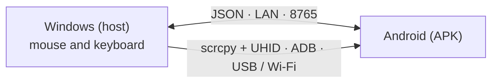

# EzAcrossControl


**Connect. Control. Continue.** · by ElementZero

Read in: [Português](../../README.md) · **[English](README.en.md)** · [Español](README.es.md) · [日本語](README.ja.md) · [Italiano](README.it.md) · [Français](README.fr.md) · [Deutsch](README.de.md) · [简体中文](README.zh-CN.md) · [Tiếng Việt](README.vi.md) · [한국어](README.ko.md) · [العربية](README.ar.md)

🌐 **Website:** [eddesignerez.github.io/EzAcrossControl](https://eddesignerez.github.io/EzAcrossControl/) · ⬇️ **Current version:** [1.1.27](https://github.com/eddesignerez/EzAcrossControl/releases/tag/v1.1.27)

Use your Windows PC's mouse and keyboard to control an Android tablet or phone, as if it were a second monitor. Move the pointer to the chosen screen edge and control passes to Android; cross back over the same edge (or press **Esc**) and control returns to Windows. Everything stays on your local network, with no account, no sign-up and no cloud services.

## Who it is for

- People who keep an Android tablet next to their PC and want one mouse and keyboard for both.
- People who want to type on their phone with a physical keyboard, reply to messages or use Android apps without leaving the desk.
- People who prefer a local solution that does not send data to third-party servers.

## Features

| Feature | How it works |
| --- | --- |
| **Edge switching** | Choose whether Android sits to the left or right of your monitor. The pointer crosses the edge and starts controlling Android. |
| **Native mouse and keyboard** | The control engine integrates [scrcpy](https://github.com/Genymobile/scrcpy) with UHID: Android sees a physical mouse and keyboard, with scrolling, clicks and shortcuts. |
| **USB or Wi‑Fi** | Connect with a cable or through wireless debugging. In **Auto** mode, USB has priority and Wi‑Fi takes over when the cable is unavailable. |
| **Local network only** | Windows and Android talk directly over the LAN (default port **8765**, configurable). There is no intermediate server. |
| **All-in-one installer** | The Windows installer already includes .NET, ADB and the control engine. No SDK or developer tools to install. |
| **Safe updates** | Both apps check the latest stable release on GitHub, show the offer and only download with your consent, verifying the SHA‑256. |
| **Tray and auto-start** | The Windows app lives in the system tray and can optionally start with Windows. |
| **11 languages, two themes** | Interface in 11 languages, with light, dark or system theme. |

## How it works



1. The Windows app captures the mouse and keyboard and watches the chosen edge.
2. When the pointer crosses the edge, control is handed to Android by the native engine (scrcpy + UHID), over USB or Wi‑Fi.
3. The Android app reports the connection state and hands control back when the pointer returns across the edge.
4. Both apps exchange messages using the JSON contract in [Protocol/protocol.md](../../Protocol/protocol.md).

## Download and install

- [Windows installer 1.1.27 (.exe)](https://github.com/eddesignerez/EzAcrossControl/releases/download/v1.1.27/EZAcrossControl-1.1.27-windows-x64-setup.exe)
- [Android app 1.1.27 (.apk)](https://github.com/eddesignerez/EzAcrossControl/releases/download/v1.1.27/EZAcrossControl-1.1.27-android.apk)
- [Portable Windows 1.1.18 (.zip)](https://github.com/eddesignerez/EzAcrossControl/releases/download/v1.1.18/EZAcrossControl-1.1.18-windows-x64-portable.zip) — latest version published as a portable build
- [All releases, third-party sources and integrity checks (SHA‑256)](https://github.com/eddesignerez/EzAcrossControl/releases)

### Requirements

| Item | Required |
| --- | --- |
| **Windows** | Windows 10 or 11, 64-bit. The installer includes .NET, ADB and the control engine. |
| **Android** | Android 7 or later. Native control depends on the device's UHID support; some manufacturer implementations may need extra settings. |
| **Network** | Windows and Android on the same local network, even when USB is chosen for the control engine. |
| **Debugging** | Authorized USB debugging, or wireless debugging enabled and paired. Wireless debugging from the Android menu requires Android 11 or later. |

### First use

1. Run the Windows installer and open **EzAcrossControl**. Setup asks for administrator permission to configure the local server and the private-network firewall.
2. Install the APK on Android. If the system asks, allow installs from the app you used to open the file.
3. In **Advanced Mode → Debugging → Open Settings**, enable developer options and the debugging method you want. Authorize the computer when Android asks.
4. For Wi‑Fi, open **Wireless debugging → Pair device with pairing code**. On the computer, run the ADB bundled with the app:

   ```powershell
   & "$env:ProgramFiles\EZ Across Control\scrcpy\adb.exe" pair <Android-IP>:<pairing-port>
   ```

   Type the code shown by Android. The pairing port and the connection port are different. If automatic discovery does not find the device, use `adb connect <Android-IP>:<connection-port>`.

5. In the APK, choose the **Connection Mode**: **Auto**, **Wi‑Fi** or **USB** (see the table below).
6. Under **Host PC**, enter the IP shown on Windows and the same port in both apps. The default port is **8765**.
7. Tap the **Connect** circle. The app tells you when control is available over Wi‑Fi or USB. Choose the Android position in the Windows app and move the pointer to that edge to switch control.

### Connection modes

Choose the mode on Windows and on Android. Both sides must agree:

| Windows ↓ / Android → | Auto | Wi‑Fi | USB |
| --- | --- | --- | --- |
| **Auto** | USB; if unavailable, Wi‑Fi | Wi‑Fi | USB |
| **Wi‑Fi** | Wi‑Fi | Wi‑Fi | ❌ Blocked |
| **USB** | USB | ❌ Blocked | USB |

If only one side is in a manual mode, that mode is used. Different manual modes block the connection; align the choices or select Auto. Manual USB mode does not fall back to Wi‑Fi. The selectors keep your choices and the transport field shows the active connection.

## Control, keyboard and settings

- **Switching screens:** move the pointer to the chosen edge. To return to Windows, cross the same edge in the opposite direction or press **Esc**.
- **Accessibility** assists remote control and the return across the edge. The user enables it from the Android menu.
- **Remote Keyboard** shows whether the helper keyboard is enabled and selected. The native engine also uses an HID keyboard; set its language/layout in Android's physical keyboard options when needed.
- **Stop Control** releases remote control and closes the APK connection. Tap Connect again to start another session.
- The **X** button on Windows sends the app to the tray. Use **Restore** to reopen it and **Exit** to close it.
- **Start with Windows** (below the language) opens the app when you sign in to Windows. It is optional, applies only to the current user and is removed when unchecked.
- The sun/moon icons switch themes. **Diagnostics** and **Activity Log** are in advanced mode.

## Updates

When opened, Windows and Android check the latest stable release published in this repository. You choose **Update Now** or **Later**; nothing is downloaded or installed without your consent. The package must have the exact name, version and address, a limited size and the SHA‑256 reported by GitHub. On Windows, the installer keeps your settings and reopens the app when it finishes. Without internet, the check fails without affecting control over the local network. Details (Portuguese) in [Docs/automatic-updates.md](../automatic-updates.md).

## Privacy and network

- Control and messages between the devices stay on the local network. There is no account, no telemetry and no cloud routing.
- The only internet traffic is the optional update check on GitHub.
- The firewall rule created by the installer only allows TCP on the chosen port, on private networks and the local subnet.

## Languages

Português, English, Español, 日本語, Italiano, Français, Deutsch, 简体中文, Tiếng Việt, 한국어 and العربية.

Android follows the system language by default. To change it, open **Advanced Mode → Language**, below debugging. On Windows, the selector is in the diagnostics section. The choice is saved locally.

## Troubleshooting

- **Debugging off or device not authorized:** open the settings the APK points to, enable the option and authorize the computer.
- **Wi‑Fi dropped:** check wireless debugging and the current port; Android may change the port after turning that option off and on. The app refreshes control availability while it is open.
- **Server unreachable:** confirm the IP, the port and that the Windows network is set to private. The installer's rule only allows the private local network.
- **Connection blocked:** the manual modes on Windows and Android differ. Choose the same mode on both or use Auto.
- **Port other than 8765:** stop the server, change the port and start it again. The app asks for Windows authorization if it needs to adjust the URL reservation or the firewall rule. The port is saved after a successful start; set the same value on Android. In version 1.1.0, custom ports require manual configuration.
- **Older test APK:** the release build uses its own signature. To migrate from a debug APK, uninstall the old version and install this one. Preferences will need to be entered again.
- **Portable Windows:** run as administrator to listen on the LAN, or configure the URL reservation/firewall. The installed version configures the default port.
- **SmartScreen warning:** the Windows installer is not Authenticode-signed yet. Check the SHA‑256 on the release page before running it.

Physical testing was done on a HiPadPlus and a LAVIE T11. On the HiPadPlus, Gboard only showed its compact bar again after the device was reset; the result may depend on the Android state and Gboard version. Compatibility with other manufacturers should be checked on your own device. The APK carries a release signature.

## Visual previews

These images are **static brand identity studies** created from the provided logo. They are not screenshots of the running app.

| Day proposal | Night proposal |
| --- | --- |
|  |  |

## Architecture and development

The WPF host (.NET 8) and the Kotlin/Compose client use the JSON contract in [Protocol/protocol.md](../../Protocol/protocol.md). The native engine integrates scrcpy with a patch for input capture and return. There is no cloud routing. See also [Docs/architecture.md](../architecture.md) and [Docs/status.md](../status.md).

| Folder | Contents |
| --- | --- |
| `Windows-host/` | Windows host, tray, capture and control engine |
| `Android-client/` | APK, circular connect button, accessibility and helper keyboard |
| `Localization/` | Shared catalog for the 11 languages |
| `Protocol/` | JSON contract between the apps |
| `Tests/` | Host tests |
| `packaging/` | Windows installer |
| `scripts/` | Language generation, builds and distribution sources |
| `patches/` | scrcpy changes |
| `site/` | Project website published on GitHub Pages |

Development requirements: .NET 8 SDK, Android SDK, JDK 17 and Node.js to generate the language catalog. To build the engine, see [Docs/v2/build-scrcpy-windows.md](../v2/build-scrcpy-windows.md).

```powershell
node scripts/build-localization.cjs
dotnet build Windows-host/WindowsHost.csproj
dotnet test Tests/WindowsHost.Tests/WindowsHost.Tests.csproj -c Release
cd Android-client
.\gradlew.bat :app:assembleDebug :app:testDebugUnitTest
```

The `build-windows-release.ps1` and `build-android-release.ps1` scripts produce the distribution packages. The release APK needs its own key; the script keeps the key and password in the ignored local folder `.release-private`. Keep that folder safe to sign future updates. Never push keys, personal preferences or logs to GitHub.

Translations live in `Localization/messages.tsv`; run the generator after changing them. Both platforms consume the catalog without changing protocol values.

## Third parties

See [THIRD-PARTY-NOTICES.md](../../THIRD-PARTY-NOTICES.md), the licenses included in the installation and the release's native source archive. These components keep their own licenses.
