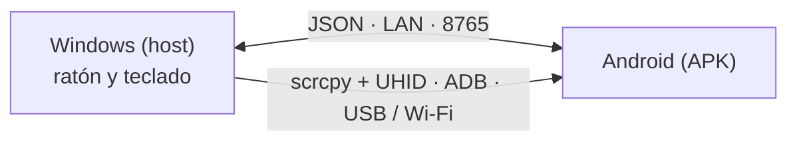

# EzAcrossControl


**Conecta. Controla. Continúa.** · by ElementZero

Leer en: [Português](../../README.md) · [English](README.en.md) · **[Español](README.es.md)** · [日本語](README.ja.md) · [Italiano](README.it.md) · [Français](README.fr.md) · [Deutsch](README.de.md) · [简体中文](README.zh-CN.md) · [Tiếng Việt](README.vi.md) · [한국어](README.ko.md) · [العربية](README.ar.md)

🌐 **Sitio web:** [eddesignerez.github.io/EzAcrossControl](https://eddesignerez.github.io/EzAcrossControl/) · ⬇️ **Versión actual:** [1.1.27](https://github.com/eddesignerez/EzAcrossControl/releases/tag/v1.1.27)

Usa el ratón y el teclado de tu PC con Windows para controlar una tableta o un teléfono Android, como si fuera un segundo monitor. Lleva el puntero al borde elegido de la pantalla y el control pasa a Android; cruza de nuevo el mismo borde (o pulsa **Esc**) y el control vuelve a Windows. Todo ocurre en tu red local, sin cuenta, sin registro y sin servicios en la nube.

## Para quién es

- Quien trabaja con una tableta Android junto al PC y quiere usar un solo ratón y teclado en ambos.
- Quien quiere escribir en el móvil con un teclado físico, responder mensajes o usar apps Android sin levantarse de la mesa.
- Quien prefiere una solución local, sin enviar datos a servidores de terceros.

## Funciones

| Función | Cómo funciona |
| --- | --- |
| **Cambio por el borde** | Elige si Android está a la izquierda o a la derecha del monitor. El puntero cruza el borde y pasa a controlar Android. |
| **Ratón y teclado nativos** | El motor de control integra [scrcpy](https://github.com/Genymobile/scrcpy) con UHID: Android ve un ratón y un teclado físicos, con desplazamiento, clics y atajos. |
| **USB o Wi‑Fi** | Conecta por cable o por depuración inalámbrica. En modo **Auto**, el USB tiene prioridad y el Wi‑Fi toma el relevo cuando el cable no está disponible. |
| **Solo red local** | Windows y Android se comunican directamente por la LAN (puerto predeterminado **8765**, configurable). No hay servidor intermedio. |
| **Instalador completo** | El instalador de Windows ya incluye .NET, ADB y el motor de control. No hace falta instalar SDK ni herramientas de desarrollo. |
| **Actualizaciones seguras** | Ambas apps consultan la última versión estable en GitHub, muestran la oferta y solo descargan con tu aceptación, validando el SHA‑256. |
| **Bandeja e inicio automático** | La app de Windows queda en la bandeja del sistema y puede iniciarse con Windows (opcional). |
| **11 idiomas y dos temas** | Interfaz en 11 idiomas, con tema claro, oscuro o automático según el sistema. |

## Cómo funciona



1. La app de Windows captura el ratón y el teclado y vigila el borde elegido.
2. Cuando el puntero cruza el borde, el motor nativo (scrcpy + UHID) entrega el control a Android por USB o Wi‑Fi.
3. La app de Android informa el estado de la conexión y devuelve el control cuando el puntero vuelve a cruzar el borde.
4. Ambas apps intercambian mensajes con el contrato JSON de [Protocol/protocol.md](../../Protocol/protocol.md).

## Descargar e instalar

- [Instalador de Windows 1.1.27 (.exe)](https://github.com/eddesignerez/EzAcrossControl/releases/download/v1.1.27/EZAcrossControl-1.1.27-windows-x64-setup.exe)
- [App Android 1.1.27 (.apk)](https://github.com/eddesignerez/EzAcrossControl/releases/download/v1.1.27/EZAcrossControl-1.1.27-android.apk)
- [Windows portátil 1.1.18 (.zip)](https://github.com/eddesignerez/EzAcrossControl/releases/download/v1.1.18/EZAcrossControl-1.1.18-windows-x64-portable.zip) — última versión publicada en formato portátil
- [Todas las versiones, fuentes de terceros y verificaciones de integridad (SHA‑256)](https://github.com/eddesignerez/EzAcrossControl/releases)

### Requisitos

| Elemento | Necesario |
| --- | --- |
| **Windows** | Windows 10 u 11, 64 bits. El instalador incluye .NET, ADB y el motor de control. |
| **Android** | Android 7 o posterior. El control nativo depende del soporte UHID del dispositivo; algunas implementaciones de fabricantes pueden requerir ajustes adicionales. |
| **Red** | Windows y Android en la misma red local, también cuando se elige USB para el motor de control. |
| **Depuración** | Depuración USB autorizada, o depuración inalámbrica activada y emparejada. La depuración inalámbrica desde el menú de Android requiere Android 11 o posterior. |

### Primer uso

1. Ejecuta el instalador de Windows y abre **EzAcrossControl**. La instalación pide permiso de administrador para configurar el servidor local y el firewall de la red privada.
2. Instala el APK en Android. Si el sistema lo pide, permite la instalación desde la app con la que abriste el archivo.
3. En **Modo Avanzado → Depuración → Abrir Ajustes**, activa las opciones de desarrollador y el método de depuración que quieras. Autoriza el ordenador cuando Android lo pregunte.
4. Para Wi‑Fi, abre **Depuración inalámbrica → Vincular dispositivo con código de vinculación**. En el ordenador, ejecuta el ADB incluido en la app:

   ```powershell
   & "$env:ProgramFiles\EZ Across Control\scrcpy\adb.exe" pair <IP-de-Android>:<puerto-de-vinculación>
   ```

   Escribe el código que muestra Android. El puerto de vinculación y el de conexión son distintos. Si la detección automática no encuentra el dispositivo, usa `adb connect <IP-de-Android>:<puerto-de-conexión>`.

5. En el APK, elige el **Modo de Conexión**: **Auto**, **Wi‑Fi** o **USB** (ver la tabla siguiente).
6. En **PC Anfitrión**, introduce la IP que muestra Windows y el mismo puerto en las dos apps. El puerto predeterminado es **8765**.
7. Toca el círculo **Conectar**. La app indica cuándo el control está disponible por Wi‑Fi o USB. Elige la posición de Android en Windows y mueve el puntero hasta ese borde para cambiar el control.

### Modos de conexión

Elige el modo en Windows y en Android. Los dos lados deben coincidir:

| Windows ↓ / Android → | Auto | Wi‑Fi | USB |
| --- | --- | --- | --- |
| **Auto** | USB; si no está disponible, Wi‑Fi | Wi‑Fi | USB |
| **Wi‑Fi** | Wi‑Fi | Wi‑Fi | ❌ Bloqueado |
| **USB** | USB | ❌ Bloqueado | USB |

Si solo un lado está en modo manual, se usa ese modo. Modos manuales distintos bloquean la conexión; alinea las elecciones o selecciona Auto. El modo USB manual no recurre al Wi‑Fi. Los selectores conservan tus elecciones y el campo de transporte muestra la conexión activa.

## Control, teclado y ajustes

- **Cambiar de pantalla:** mueve el puntero hasta el borde elegido. Para volver a Windows, cruza el mismo borde en sentido contrario o pulsa **Esc**.
- **Accesibilidad** ayuda al control remoto y al regreso por el borde. La activa el usuario desde el menú de Android.
- **Teclado Remoto** indica si el teclado auxiliar está activado y seleccionado. El motor nativo también usa un teclado HID; configura su idioma/distribución en las opciones de teclado físico de Android cuando sea necesario.
- **Detener Control** libera el control remoto y cierra la conexión del APK. Toca Conectar de nuevo para iniciar otra sesión.
- El botón **X** en Windows envía la app a la bandeja. Usa **Restaurar** para volver a abrirla y **Salir** para cerrarla.
- **Iniciar con Windows** (debajo del idioma) abre la app al iniciar sesión en Windows. Es opcional, solo afecta al usuario actual y se elimina al desmarcarla.
- Los iconos de sol/luna cambian el tema. **Diagnóstico** y **Registro de Actividad** están en el modo avanzado.

## Actualizaciones

Al abrirse, Windows y Android consultan la última versión estable publicada en este repositorio. Tú eliges **Actualizar ahora** o **Más tarde**; nada se descarga ni se instala sin tu aceptación. El paquete debe tener nombre, versión y dirección exactos, tamaño limitado y el SHA‑256 informado por GitHub. En Windows, el instalador conserva los ajustes y vuelve a abrir la app al terminar. Sin internet, la consulta falla sin afectar el control por la red local. Detalles (en portugués) en [Docs/automatic-updates.md](../automatic-updates.md).

## Privacidad y red

- El control y los mensajes entre los dispositivos se quedan en la red local. No hay cuenta, telemetría ni enrutamiento por la nube.
- La única comunicación con internet es la consulta opcional de actualizaciones en GitHub.
- La regla de firewall creada por el instalador solo permite TCP en el puerto elegido, en redes privadas y en la subred local.

## Idiomas

Português, English, Español, 日本語, Italiano, Français, Deutsch, 简体中文, Tiếng Việt, 한국어 y العربية.

Android sigue el idioma del sistema de forma predeterminada. Para cambiarlo, abre **Modo Avanzado → Idioma**, debajo de la depuración. En Windows, el selector está en la sección de diagnóstico. La elección se guarda localmente.

## Solución de problemas

- **Depuración desactivada o dispositivo no autorizado:** abre los ajustes que indica el APK, activa la opción y autoriza el ordenador.
- **Se cayó el Wi‑Fi:** revisa la depuración inalámbrica y el puerto actual; Android puede cambiar el puerto tras desactivar y activar esa opción. La app actualiza la disponibilidad del control mientras está abierta.
- **Servidor inaccesible:** confirma la IP, el puerto y que la red de Windows esté marcada como privada. La regla del instalador solo permite la red local privada.
- **Conexión bloqueada:** los modos manuales de Windows y Android son diferentes. Elige el mismo modo en ambos o usa Auto.
- **Puerto distinto de 8765:** detén el servidor, cambia el puerto e inícialo de nuevo. La app pide autorización de Windows si necesita ajustar la reserva de URL o la regla del firewall. El puerto se guarda tras un inicio correcto; configura el mismo valor en Android. En la versión 1.1.0, los puertos personalizados requieren configuración manual.
- **APK de pruebas anterior:** la versión de distribución usa su propia firma. Para migrar desde un APK de depuración, desinstala la versión antigua e instala esta. Habrá que volver a introducir las preferencias.
- **Windows portátil:** ejecútalo como administrador para escuchar en la LAN o configura la reserva de URL/firewall. La versión instalable configura el puerto predeterminado.
- **Aviso de SmartScreen:** el instalador de Windows aún no tiene firma Authenticode. Comprueba el SHA‑256 en la página de la versión antes de ejecutarlo.

Las pruebas físicas se hicieron en un HiPadPlus y un LAVIE T11. En el HiPadPlus, Gboard solo volvió a mostrar la barra reducida tras restablecer el dispositivo; el resultado puede depender del estado de Android y de la versión de Gboard. La compatibilidad con otros fabricantes debe comprobarse en el dispositivo usado. El APK tiene firma de distribución.

## Vistas previas

Estas imágenes son **estudios estáticos de la identidad visual** creados a partir del logotipo proporcionado. No son capturas de la app en ejecución.

| Propuesta Day | Propuesta Night |
| --- | --- |
|  |  |

## Arquitectura y desarrollo

El host WPF (.NET 8) y el cliente Kotlin/Compose usan el contrato JSON de [Protocol/protocol.md](../../Protocol/protocol.md). El motor nativo integra scrcpy con un parche para la captura y el retorno de entrada. No hay enrutamiento por la nube. Consulta también [Docs/architecture.md](../architecture.md) y [Docs/status.md](../status.md).

| Carpeta | Contenido |
| --- | --- |
| `Windows-host/` | Host de Windows, bandeja, captura y motor de control |
| `Android-client/` | APK, botón circular de conexión, accesibilidad y teclado auxiliar |
| `Localization/` | Catálogo compartido de los 11 idiomas |
| `Protocol/` | Contrato JSON entre las apps |
| `Tests/` | Pruebas del host |
| `packaging/` | Instalador de Windows |
| `scripts/` | Generación de idiomas, compilaciones y fuentes de distribución |
| `patches/` | Cambios en scrcpy |
| `site/` | Sitio del proyecto publicado en GitHub Pages |

Requisitos de desarrollo: .NET 8 SDK, Android SDK, JDK 17 y Node.js para generar el catálogo de idiomas. Para compilar el motor, consulta [Docs/v2/build-scrcpy-windows.md](../v2/build-scrcpy-windows.md).

```powershell
node scripts/build-localization.cjs
dotnet build Windows-host/WindowsHost.csproj
dotnet test Tests/WindowsHost.Tests/WindowsHost.Tests.csproj -c Release
cd Android-client
.\gradlew.bat :app:assembleDebug :app:testDebugUnitTest
```

Los scripts `build-windows-release.ps1` y `build-android-release.ps1` generan los paquetes de distribución. El APK de release necesita su propia clave; el script guarda la clave y la contraseña en la carpeta local ignorada `.release-private`. Guarda esa carpeta de forma segura para firmar futuras actualizaciones. Nunca subas claves, preferencias personales ni registros a GitHub.

Las traducciones están en `Localization/messages.tsv`; ejecuta el generador después de modificarlas. Ambas plataformas usan el catálogo sin cambiar los valores del protocolo.

## Terceros

Consulta [THIRD-PARTY-NOTICES.md](../../THIRD-PARTY-NOTICES.md), las licencias incluidas en la instalación y el archivo de fuentes nativas de la versión. Estos componentes mantienen sus propias licencias.
