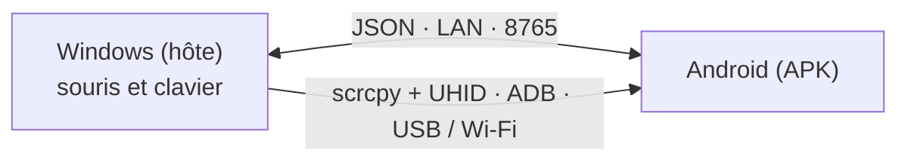

# EzAcrossControl


**Connecter. Contrôler. Continuer.** · by ElementZero

Lire en : [Português](../../README.md) · [English](README.en.md) · [Español](README.es.md) · [日本語](README.ja.md) · [Italiano](README.it.md) · **[Français](README.fr.md)** · [Deutsch](README.de.md) · [简体中文](README.zh-CN.md) · [Tiếng Việt](README.vi.md) · [한국어](README.ko.md) · [العربية](README.ar.md)

🌐 **Site web :** [eddesignerez.github.io/EzAcrossControl](https://eddesignerez.github.io/EzAcrossControl/) · ⬇️ **Version actuelle :** [1.1.27](https://github.com/eddesignerez/EzAcrossControl/releases/tag/v1.1.27)

Utilisez la souris et le clavier de votre PC Windows pour contrôler une tablette ou un téléphone Android, comme s’il s’agissait d’un second écran. Amenez le pointeur sur le bord choisi de l’écran et le contrôle passe à Android ; retraversez le même bord (ou appuyez sur **Échap**) et le contrôle revient à Windows. Tout se passe sur votre réseau local, sans compte, sans inscription et sans service cloud.

## Pour qui

- Celles et ceux qui travaillent avec une tablette Android à côté du PC et veulent une seule souris et un seul clavier pour les deux.
- Celles et ceux qui veulent écrire sur leur téléphone avec un clavier physique, répondre aux messages ou utiliser des applis Android sans quitter le bureau.
- Celles et ceux qui préfèrent une solution locale, sans envoi de données à des serveurs tiers.

## Fonctionnalités

| Fonctionnalité | Fonctionnement |
| --- | --- |
| **Bascule par le bord** | Choisissez si Android se trouve à gauche ou à droite de l’écran. Le pointeur franchit le bord et contrôle alors Android. |
| **Souris et clavier natifs** | Le moteur de contrôle intègre [scrcpy](https://github.com/Genymobile/scrcpy) avec UHID : Android voit une souris et un clavier physiques, avec défilement, clics et raccourcis. |
| **USB ou Wi‑Fi** | Connectez-vous par câble ou par débogage sans fil. En mode **Auto**, l’USB est prioritaire et le Wi‑Fi prend le relais quand le câble n’est pas disponible. |
| **Réseau local uniquement** | Windows et Android communiquent directement sur le LAN (port par défaut **8765**, configurable). Aucun serveur intermédiaire. |
| **Installateur complet** | L’installateur Windows inclut déjà .NET, ADB et le moteur de contrôle. Aucun SDK ni outil de développement à installer. |
| **Mises à jour sûres** | Les deux applis vérifient la dernière version stable sur GitHub, proposent la mise à jour et ne téléchargent qu’avec votre accord, en vérifiant le SHA‑256. |
| **Zone de notification et démarrage automatique** | L’appli Windows reste dans la zone de notification et peut démarrer avec Windows (facultatif). |
| **11 langues et deux thèmes** | Interface en 11 langues, avec thème clair, sombre ou automatique selon le système. |

## Fonctionnement



1. L’appli Windows capture la souris et le clavier et surveille le bord choisi.
2. Quand le pointeur franchit le bord, le moteur natif (scrcpy + UHID) transmet le contrôle à Android par USB ou Wi‑Fi.
3. L’appli Android affiche l’état de la connexion et rend le contrôle quand le pointeur repasse le bord.
4. Les deux applis échangent des messages selon le contrat JSON de [Protocol/protocol.md](../../Protocol/protocol.md).

## Télécharger et installer

- [Installateur Windows 1.1.27 (.exe)](https://github.com/eddesignerez/EzAcrossControl/releases/download/v1.1.27/EZAcrossControl-1.1.27-windows-x64-setup.exe)
- [Appli Android 1.1.27 (.apk)](https://github.com/eddesignerez/EzAcrossControl/releases/download/v1.1.27/EZAcrossControl-1.1.27-android.apk)
- [Windows portable 1.1.18 (.zip)](https://github.com/eddesignerez/EzAcrossControl/releases/download/v1.1.18/EZAcrossControl-1.1.18-windows-x64-portable.zip) — dernière version publiée au format portable
- [Toutes les versions, sources tierces et contrôles d’intégrité (SHA‑256)](https://github.com/eddesignerez/EzAcrossControl/releases)

### Configuration requise

| Élément | Requis |
| --- | --- |
| **Windows** | Windows 10 ou 11, 64 bits. L’installateur inclut .NET, ADB et le moteur de contrôle. |
| **Android** | Android 7 ou ultérieur. Le contrôle natif dépend de la prise en charge UHID de l’appareil ; certaines implémentations constructeur peuvent demander des réglages supplémentaires. |
| **Réseau** | Windows et Android sur le même réseau local, y compris quand l’USB est choisi pour le moteur de contrôle. |
| **Débogage** | Débogage USB autorisé, ou débogage sans fil activé et associé. Le débogage sans fil depuis le menu Android nécessite Android 11 ou ultérieur. |

### Première utilisation

1. Lancez l’installateur Windows et ouvrez **EzAcrossControl**. L’installation demande les droits d’administrateur pour configurer le serveur local et le pare-feu du réseau privé.
2. Installez l’APK sur Android. Si le système le demande, autorisez l’installation depuis l’appli utilisée pour ouvrir le fichier.
3. Dans **Mode Avancé → Débogage → Ouvrir les Paramètres**, activez les options pour les développeurs et la méthode de débogage souhaitée. Autorisez l’ordinateur quand Android le demande.
4. Pour le Wi‑Fi, ouvrez **Débogage sans fil → Associer l’appareil avec un code d’association**. Sur l’ordinateur, exécutez l’ADB fourni avec l’appli :

   ```powershell
   & "$env:ProgramFiles\EZ Across Control\scrcpy\adb.exe" pair <IP-Android>:<port-d-association>
   ```

   Saisissez le code affiché par Android. Le port d’association et le port de connexion sont différents. Si la détection automatique ne trouve pas l’appareil, utilisez `adb connect <IP-Android>:<port-de-connexion>`.

5. Dans l’APK, choisissez le **Mode de Connexion** : **Auto**, **Wi‑Fi** ou **USB** (voir le tableau ci-dessous).
6. Dans **PC Hôte**, saisissez l’IP affichée sous Windows et le même port dans les deux applis. Le port par défaut est **8765**.
7. Touchez le cercle **Connecter**. L’appli indique quand le contrôle est disponible par Wi‑Fi ou USB. Choisissez la position d’Android dans Windows et amenez le pointeur sur ce bord pour basculer le contrôle.

### Modes de connexion

Choisissez le mode sous Windows et sous Android. Les deux côtés doivent concorder :

| Windows ↓ / Android → | Auto | Wi‑Fi | USB |
| --- | --- | --- | --- |
| **Auto** | USB ; sinon Wi‑Fi | Wi‑Fi | USB |
| **Wi‑Fi** | Wi‑Fi | Wi‑Fi | ❌ Bloqué |
| **USB** | USB | ❌ Bloqué | USB |

Si un seul côté est en mode manuel, ce mode est utilisé. Des modes manuels différents bloquent la connexion ; alignez les choix ou sélectionnez Auto. Le mode USB manuel ne bascule pas vers le Wi‑Fi. Les sélecteurs conservent vos choix et le champ de transport indique la connexion active.

## Contrôle, clavier et réglages

- **Changer d’écran :** amenez le pointeur sur le bord choisi. Pour revenir à Windows, retraversez le même bord en sens inverse ou appuyez sur **Échap**.
- **Accessibilité** facilite le contrôle à distance et le retour par le bord. L’utilisateur l’active depuis le menu Android.
- **Clavier à Distance** indique si le clavier auxiliaire est activé et sélectionné. Le moteur natif utilise aussi un clavier HID ; réglez sa langue/disposition dans les options de clavier physique d’Android si nécessaire.
- **Arrêter le Contrôle** libère le contrôle à distance et ferme la connexion de l’APK. Touchez à nouveau Connecter pour démarrer une autre session.
- Le bouton **X** sous Windows envoie l’appli dans la zone de notification. Utilisez **Restaurer** pour la rouvrir et **Quitter** pour la fermer.
- **Démarrer avec Windows** (sous la langue) ouvre l’appli à l’ouverture de session Windows. C’est facultatif, ne s’applique qu’à l’utilisateur actuel et est retiré quand on décoche l’option.
- Les icônes soleil/lune changent le thème. **Diagnostic** et **Journal d’Activité** se trouvent dans le mode avancé.

## Mises à jour

À l’ouverture, Windows et Android vérifient la dernière version stable publiée dans ce dépôt. Vous choisissez **Mettre à jour** ou **Plus tard** ; rien n’est téléchargé ni installé sans votre accord. Le paquet doit avoir le nom, la version et l’adresse exacts, une taille limitée et le SHA‑256 fourni par GitHub. Sous Windows, l’installateur conserve les réglages et rouvre l’appli à la fin. Sans internet, la vérification échoue sans affecter le contrôle sur le réseau local. Détails (en portugais) dans [Docs/automatic-updates.md](../automatic-updates.md).

## Confidentialité et réseau

- Le contrôle et les messages entre les appareils restent sur le réseau local. Pas de compte, pas de télémétrie, pas de routage par le cloud.
- La seule communication avec internet est la vérification facultative des mises à jour sur GitHub.
- La règle de pare-feu créée par l’installateur n’autorise que le TCP sur le port choisi, sur les réseaux privés et le sous-réseau local.

## Langues

Português, English, Español, 日本語, Italiano, Français, Deutsch, 简体中文, Tiếng Việt, 한국어 et العربية.

Android suit la langue du système par défaut. Pour la changer, ouvrez **Mode Avancé → Langue**, sous le débogage. Sous Windows, le sélecteur se trouve dans la section de diagnostic. Le choix est enregistré localement.

## Dépannage

- **Débogage désactivé ou appareil non autorisé :** ouvrez les paramètres indiqués par l’APK, activez l’option et autorisez l’ordinateur.
- **Le Wi‑Fi a décroché :** vérifiez le débogage sans fil et le port actuel ; Android peut changer de port après avoir désactivé puis réactivé l’option. L’appli met à jour la disponibilité du contrôle tant qu’elle est ouverte.
- **Serveur injoignable :** vérifiez l’IP, le port et que le réseau Windows est défini comme privé. La règle de l’installateur n’autorise que le réseau local privé.
- **Connexion bloquée :** les modes manuels de Windows et d’Android sont différents. Choisissez le même mode des deux côtés ou utilisez Auto.
- **Port autre que 8765 :** arrêtez le serveur, changez le port et redémarrez-le. L’appli demande l’autorisation de Windows si elle doit ajuster la réservation d’URL ou la règle de pare-feu. Le port est enregistré après un démarrage réussi ; saisissez la même valeur sur Android. Dans la version 1.1.0, les ports personnalisés nécessitent une configuration manuelle.
- **Ancien APK de test :** la version de distribution utilise sa propre signature. Pour migrer depuis un APK de débogage, désinstallez l’ancienne version puis installez celle-ci. Les préférences devront être ressaisies.
- **Windows portable :** exécutez-le en tant qu’administrateur pour écouter sur le LAN, ou configurez la réservation d’URL/le pare-feu. La version installée configure le port par défaut.
- **Avertissement SmartScreen :** l’installateur Windows n’a pas encore de signature Authenticode. Vérifiez le SHA‑256 sur la page de la version avant de l’exécuter.

Les tests physiques ont été réalisés sur un HiPadPlus et un LAVIE T11. Sur le HiPadPlus, Gboard n’a réaffiché sa barre réduite qu’après la réinitialisation de l’appareil ; le résultat peut dépendre de l’état d’Android et de la version de Gboard. La compatibilité avec d’autres constructeurs doit être vérifiée sur l’appareil utilisé. L’APK possède une signature de distribution.

## Aperçus visuels

Ces images sont des **études statiques de l’identité visuelle** créées à partir du logo fourni. Ce ne sont pas des captures de l’appli en fonctionnement.

| Proposition Day | Proposition Night |
| --- | --- |
|  |  |

## Architecture et développement

L’hôte WPF (.NET 8) et le client Kotlin/Compose utilisent le contrat JSON de [Protocol/protocol.md](../../Protocol/protocol.md). Le moteur natif intègre scrcpy avec un correctif pour la capture et le retour de l’entrée. Aucun routage par le cloud. Voir aussi [Docs/architecture.md](../architecture.md) et [Docs/status.md](../status.md).

| Dossier | Contenu |
| --- | --- |
| `Windows-host/` | Hôte Windows, zone de notification, capture et moteur de contrôle |
| `Android-client/` | APK, bouton de connexion circulaire, accessibilité et clavier auxiliaire |
| `Localization/` | Catalogue partagé des 11 langues |
| `Protocol/` | Contrat JSON entre les applis |
| `Tests/` | Tests de l’hôte |
| `packaging/` | Installateur Windows |
| `scripts/` | Génération des langues, compilations et sources de distribution |
| `patches/` | Modifications de scrcpy |
| `site/` | Site du projet publié sur GitHub Pages |

Prérequis de développement : .NET 8 SDK, Android SDK, JDK 17 et Node.js pour générer le catalogue des langues. Pour compiler le moteur, consultez [Docs/v2/build-scrcpy-windows.md](../v2/build-scrcpy-windows.md).

```powershell
node scripts/build-localization.cjs
dotnet build Windows-host/WindowsHost.csproj
dotnet test Tests/WindowsHost.Tests/WindowsHost.Tests.csproj -c Release
cd Android-client
.\gradlew.bat :app:assembleDebug :app:testDebugUnitTest
```

Les scripts `build-windows-release.ps1` et `build-android-release.ps1` génèrent les paquets de distribution. L’APK de release nécessite sa propre clé ; le script conserve la clé et le mot de passe dans le dossier local ignoré `.release-private`. Conservez ce dossier en sécurité pour signer les futures mises à jour. N’envoyez jamais de clés, de préférences personnelles ni de journaux sur GitHub.

Les traductions se trouvent dans `Localization/messages.tsv` ; lancez le générateur après les avoir modifiées. Le catalogue est utilisé par les deux plateformes sans modifier les valeurs du protocole.

## Tiers

Consultez [THIRD-PARTY-NOTICES.md](../../THIRD-PARTY-NOTICES.md), les licences incluses dans l’installation et l’archive des sources natives de la version. Ces composants conservent leurs propres licences.
