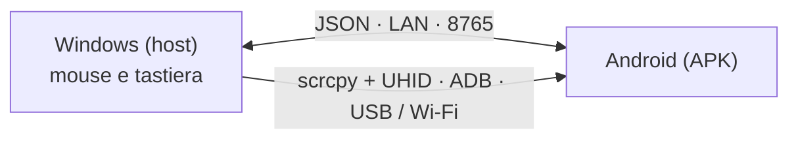

# EzAcrossControl


**Connetti. Controlla. Continua.** · by ElementZero

Leggi in: [Português](../../README.md) · [English](README.en.md) · [Español](README.es.md) · [日本語](README.ja.md) · **[Italiano](README.it.md)** · [Français](README.fr.md) · [Deutsch](README.de.md) · [简体中文](README.zh-CN.md) · [Tiếng Việt](README.vi.md) · [한국어](README.ko.md) · [العربية](README.ar.md)

🌐 **Sito web:** [eddesignerez.github.io/EzAcrossControl](https://eddesignerez.github.io/EzAcrossControl/) · ⬇️ **Versione attuale:** [1.1.27](https://github.com/eddesignerez/EzAcrossControl/releases/tag/v1.1.27)

Usa il mouse e la tastiera del tuo PC Windows per controllare un tablet o uno smartphone Android, come se fosse un secondo monitor. Porta il puntatore sul bordo scelto dello schermo e il controllo passa ad Android; riattraversa lo stesso bordo (o premi **Esc**) e il controllo torna a Windows. Tutto avviene nella tua rete locale, senza account, senza registrazione e senza servizi cloud.

## Per chi è

- Chi lavora con un tablet Android accanto al PC e vuole usare un solo mouse e una sola tastiera per entrambi.
- Chi vuole scrivere sullo smartphone con una tastiera fisica, rispondere ai messaggi o usare app Android senza alzarsi dalla scrivania.
- Chi preferisce una soluzione locale, che non invia dati a server di terzi.

## Funzionalità

| Funzionalità | Come funziona |
| --- | --- |
| **Cambio dal bordo** | Scegli se Android si trova a sinistra o a destra del monitor. Il puntatore attraversa il bordo e passa a controllare Android. |
| **Mouse e tastiera nativi** | Il motore di controllo integra [scrcpy](https://github.com/Genymobile/scrcpy) con UHID: Android vede un mouse e una tastiera fisici, con scorrimento, clic e scorciatoie. |
| **USB o Wi‑Fi** | Collegati via cavo o tramite debug wireless. In modalità **Auto** l'USB ha la priorità e il Wi‑Fi subentra quando il cavo non è disponibile. |
| **Solo rete locale** | Windows e Android comunicano direttamente sulla LAN (porta predefinita **8765**, configurabile). Nessun server intermedio. |
| **Installer completo** | L'installer di Windows include già .NET, ADB e il motore di controllo. Non serve installare SDK o strumenti per sviluppatori. |
| **Aggiornamenti sicuri** | Entrambe le app controllano l'ultima versione stabile su GitHub, mostrano l'offerta e scaricano solo con il tuo consenso, verificando lo SHA‑256. |
| **Area di notifica e avvio automatico** | L'app di Windows resta nell'area di notifica e può avviarsi con Windows (opzionale). |
| **11 lingue e due temi** | Interfaccia in 11 lingue, con tema chiaro, scuro o automatico in base al sistema. |

## Come funziona



1. L'app di Windows cattura mouse e tastiera e osserva il bordo scelto.
2. Quando il puntatore attraversa il bordo, il motore nativo (scrcpy + UHID) passa il controllo ad Android via USB o Wi‑Fi.
3. L'app Android mostra lo stato della connessione e restituisce il controllo quando il puntatore torna oltre il bordo.
4. Le due app si scambiano messaggi con il contratto JSON di [Protocol/protocol.md](../../Protocol/protocol.md).

## Scarica e installa

- [Installer Windows 1.1.27 (.exe)](https://github.com/eddesignerez/EzAcrossControl/releases/download/v1.1.27/EZAcrossControl-1.1.27-windows-x64-setup.exe)
- [App Android 1.1.27 (.apk)](https://github.com/eddesignerez/EzAcrossControl/releases/download/v1.1.27/EZAcrossControl-1.1.27-android.apk)
- [Windows portatile 1.1.18 (.zip)](https://github.com/eddesignerez/EzAcrossControl/releases/download/v1.1.18/EZAcrossControl-1.1.18-windows-x64-portable.zip) — ultima versione pubblicata in formato portatile
- [Tutte le versioni, sorgenti di terze parti e verifiche di integrità (SHA‑256)](https://github.com/eddesignerez/EzAcrossControl/releases)

### Requisiti

| Elemento | Necessario |
| --- | --- |
| **Windows** | Windows 10 o 11, 64 bit. L'installer include .NET, ADB e il motore di controllo. |
| **Android** | Android 7 o successivo. Il controllo nativo dipende dal supporto UHID del dispositivo; alcune implementazioni dei produttori possono richiedere impostazioni aggiuntive. |
| **Rete** | Windows e Android sulla stessa rete locale, anche quando si sceglie l'USB per il motore di controllo. |
| **Debug** | Debug USB autorizzato, oppure debug wireless attivato e associato. Il debug wireless dal menu di Android richiede Android 11 o successivo. |

### Primo utilizzo

1. Esegui l'installer di Windows e apri **EzAcrossControl**. L'installazione chiede i permessi di amministratore per configurare il server locale e il firewall della rete privata.
2. Installa l'APK su Android. Se il sistema lo chiede, consenti l'installazione dall'app usata per aprire il file.
3. In **Modalità Avanzata → Debug → Apri Impostazioni**, attiva le opzioni sviluppatore e il metodo di debug desiderato. Autorizza il computer quando Android lo chiede.
4. Per il Wi‑Fi, apri **Debug wireless → Associa dispositivo con codice di associazione**. Sul computer, esegui l'ADB incluso nell'app:

   ```powershell
   & "$env:ProgramFiles\EZ Across Control\scrcpy\adb.exe" pair <IP-di-Android>:<porta-di-associazione>
   ```

   Digita il codice mostrato da Android. La porta di associazione e quella di connessione sono diverse. Se il rilevamento automatico non trova il dispositivo, usa `adb connect <IP-di-Android>:<porta-di-connessione>`.

5. Nell'APK, scegli la **Modalità Connessione**: **Auto**, **Wi‑Fi** o **USB** (vedi la tabella seguente).
6. In **PC Host**, inserisci l'IP mostrato da Windows e la stessa porta in entrambe le app. La porta predefinita è **8765**.
7. Tocca il cerchio **Connetti**. L'app indica quando il controllo è disponibile via Wi‑Fi o USB. Scegli la posizione di Android in Windows e porta il puntatore su quel bordo per cambiare il controllo.

### Modalità di connessione

Scegli la modalità su Windows e su Android. I due lati devono corrispondere:

| Windows ↓ / Android → | Auto | Wi‑Fi | USB |
| --- | --- | --- | --- |
| **Auto** | USB; se non disponibile, Wi‑Fi | Wi‑Fi | USB |
| **Wi‑Fi** | Wi‑Fi | Wi‑Fi | ❌ Bloccata |
| **USB** | USB | ❌ Bloccata | USB |

Se solo un lato è in modalità manuale, viene usata quella modalità. Modalità manuali diverse bloccano la connessione; allinea le scelte o seleziona Auto. La modalità USB manuale non ripiega sul Wi‑Fi. I selettori conservano le tue scelte e il campo di trasporto mostra la connessione attiva.

## Controllo, tastiera e impostazioni

- **Cambio schermo:** porta il puntatore sul bordo scelto. Per tornare a Windows, attraversa lo stesso bordo in senso opposto o premi **Esc**.
- **Accessibilità** supporta il controllo remoto e il ritorno dal bordo. L'utente la attiva dal menu di Android.
- **Tastiera Remota** indica se la tastiera ausiliaria è attivata e selezionata. Il motore nativo usa anche una tastiera HID; imposta lingua/layout nelle opzioni della tastiera fisica di Android se necessario.
- **Ferma Controllo** rilascia il controllo remoto e chiude la connessione dell'APK. Tocca di nuovo Connetti per avviare un'altra sessione.
- Il pulsante **X** su Windows riduce l'app nell'area di notifica. Usa **Ripristina** per riaprirla ed **Esci** per chiuderla.
- **Avvia con Windows** (sotto la lingua) apre l'app all'accesso a Windows. È opzionale, vale solo per l'utente corrente e viene rimossa quando la deselezioni.
- Le icone sole/luna cambiano tema. **Diagnostica** e **Registro Attività** si trovano nella modalità avanzata.

## Aggiornamenti

All'apertura, Windows e Android controllano l'ultima versione stabile pubblicata in questo repository. Scegli **Aggiorna ora** o **Più tardi**; nulla viene scaricato o installato senza il tuo consenso. Il pacchetto deve avere nome, versione e indirizzo esatti, dimensione limitata e lo SHA‑256 fornito da GitHub. Su Windows l'installer conserva le impostazioni e riapre l'app al termine. Senza internet il controllo fallisce senza influire sul controllo in rete locale. Dettagli (in portoghese) in [Docs/automatic-updates.md](../automatic-updates.md).

## Privacy e rete

- Il controllo e i messaggi tra i dispositivi restano nella rete locale. Nessun account, nessuna telemetria, nessun instradamento via cloud.
- L'unica comunicazione con internet è il controllo facoltativo degli aggiornamenti su GitHub.
- La regola del firewall creata dall'installer consente solo TCP sulla porta scelta, su reti private e nella sottorete locale.

## Lingue

Português, English, Español, 日本語, Italiano, Français, Deutsch, 简体中文, Tiếng Việt, 한국어 e العربية.

Android segue la lingua di sistema per impostazione predefinita. Per cambiarla, apri **Modalità Avanzata → Lingua**, sotto il debug. Su Windows il selettore si trova nella sezione di diagnostica. La scelta viene salvata localmente.

## Risoluzione dei problemi

- **Debug disattivato o dispositivo non autorizzato:** apri le impostazioni indicate dall'APK, attiva l'opzione e autorizza il computer.
- **Wi‑Fi interrotto:** controlla il debug wireless e la porta attuale; Android può cambiare porta dopo aver disattivato e riattivato l'opzione. L'app aggiorna la disponibilità del controllo mentre è aperta.
- **Server irraggiungibile:** verifica IP, porta e che la rete di Windows sia impostata come privata. La regola dell'installer consente solo la rete locale privata.
- **Connessione bloccata:** le modalità manuali di Windows e Android sono diverse. Scegli la stessa modalità su entrambi o usa Auto.
- **Porta diversa da 8765:** ferma il server, cambia la porta e avvialo di nuovo. L'app chiede l'autorizzazione di Windows se deve modificare la prenotazione URL o la regola del firewall. La porta viene salvata dopo un avvio riuscito; imposta lo stesso valore su Android. Nella versione 1.1.0 le porte personalizzate richiedono una configurazione manuale.
- **APK di test precedente:** la versione di distribuzione usa una firma propria. Per migrare da un APK di debug, disinstalla la versione vecchia e installa questa. Le preferenze andranno reinserite.
- **Windows portatile:** eseguilo come amministratore per restare in ascolto sulla LAN o configura prenotazione URL/firewall. La versione installabile configura la porta predefinita.
- **Avviso di SmartScreen:** l'installer di Windows non ha ancora la firma Authenticode. Verifica lo SHA‑256 nella pagina della versione prima di eseguirlo.

I test fisici sono stati eseguiti su un HiPadPlus e un LAVIE T11. Sull'HiPadPlus, Gboard ha mostrato di nuovo la barra ridotta solo dopo il ripristino del dispositivo; il risultato può dipendere dallo stato di Android e dalla versione di Gboard. La compatibilità con altri produttori va verificata sul dispositivo usato. L'APK ha una firma di distribuzione.

## Anteprime visive

Queste immagini sono **studi statici dell'identità visiva** creati a partire dal logo fornito. Non sono schermate dell'app in esecuzione.

| Proposta Day | Proposta Night |
| --- | --- |
|  |  |

## Architettura e sviluppo

L'host WPF (.NET 8) e il client Kotlin/Compose usano il contratto JSON di [Protocol/protocol.md](../../Protocol/protocol.md). Il motore nativo integra scrcpy con una patch per la cattura e il ritorno dell'input. Nessun instradamento via cloud. Vedi anche [Docs/architecture.md](../architecture.md) e [Docs/status.md](../status.md).

| Cartella | Contenuto |
| --- | --- |
| `Windows-host/` | Host Windows, area di notifica, cattura e motore di controllo |
| `Android-client/` | APK, pulsante di connessione circolare, accessibilità e tastiera ausiliaria |
| `Localization/` | Catalogo condiviso delle 11 lingue |
| `Protocol/` | Contratto JSON tra le app |
| `Tests/` | Test dell'host |
| `packaging/` | Installer Windows |
| `scripts/` | Generazione delle lingue, build e sorgenti di distribuzione |
| `patches/` | Modifiche a scrcpy |
| `site/` | Sito del progetto pubblicato su GitHub Pages |

Requisiti di sviluppo: .NET 8 SDK, Android SDK, JDK 17 e Node.js per generare il catalogo delle lingue. Per compilare il motore, vedi [Docs/v2/build-scrcpy-windows.md](../v2/build-scrcpy-windows.md).

```powershell
node scripts/build-localization.cjs
dotnet build Windows-host/WindowsHost.csproj
dotnet test Tests/WindowsHost.Tests/WindowsHost.Tests.csproj -c Release
cd Android-client
.\gradlew.bat :app:assembleDebug :app:testDebugUnitTest
```

Gli script `build-windows-release.ps1` e `build-android-release.ps1` generano i pacchetti di distribuzione. L'APK di release richiede una chiave propria; lo script conserva chiave e password nella cartella locale ignorata `.release-private`. Conserva questa cartella in modo sicuro per firmare gli aggiornamenti futuri. Non inviare mai chiavi, preferenze personali o log a GitHub.

Le traduzioni si trovano in `Localization/messages.tsv`; esegui il generatore dopo averle modificate. Il catalogo è usato da entrambe le piattaforme senza modificare i valori del protocollo.

## Terze parti

Consulta [THIRD-PARTY-NOTICES.md](../../THIRD-PARTY-NOTICES.md), le licenze incluse nell'installazione e l'archivio dei sorgenti nativi della release. Questi componenti mantengono le proprie licenze.
