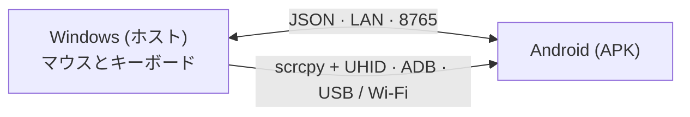

# EzAcrossControl


**つなぐ。操作する。続ける。** · by ElementZero

言語: [Português](../../README.md) · [English](README.en.md) · [Español](README.es.md) · **[日本語](README.ja.md)** · [Italiano](README.it.md) · [Français](README.fr.md) · [Deutsch](README.de.md) · [简体中文](README.zh-CN.md) · [Tiếng Việt](README.vi.md) · [한국어](README.ko.md) · [العربية](README.ar.md)

🌐 **Web サイト:** [eddesignerez.github.io/EzAcrossControl](https://eddesignerez.github.io/EzAcrossControl/) · ⬇️ **最新バージョン:** [1.1.27](https://github.com/eddesignerez/EzAcrossControl/releases/tag/v1.1.27)

Windows PC のマウスとキーボードで、Android タブレットやスマートフォンを 2 台目のモニターのように操作できます。選んだ画面の端までポインターを動かすと操作が Android に切り替わり、同じ端を戻る（または **Esc** を押す）と Windows に戻ります。すべてローカルネットワーク内で完結し、アカウント登録もクラウドサービスも不要です。

## こんな方に

- PC の横に Android タブレットを置き、1 組のマウスとキーボードで両方を使いたい方。
- 物理キーボードでスマートフォンに入力したり、机から手を離さずにメッセージ返信や Android アプリを操作したい方。
- データを第三者のサーバーに送らない、ローカル完結のソリューションを好む方。

## 主な機能

| 機能 | 仕組み |
| --- | --- |
| **画面端での切り替え** | Android をモニターの左右どちらに置くかを選びます。ポインターが端を越えると Android の操作に切り替わります。 |
| **ネイティブのマウスとキーボード** | 制御エンジンは [scrcpy](https://github.com/Genymobile/scrcpy) を UHID で統合しています。Android からは物理マウスとキーボードとして認識され、スクロール、クリック、ショートカットが使えます。 |
| **USB または Wi‑Fi** | ケーブル接続またはワイヤレスデバッグで接続します。**自動**モードでは USB が優先され、ケーブルが使えないときは Wi‑Fi に切り替わります。 |
| **ローカルネットワークのみ** | Windows と Android は LAN で直接通信します（既定ポート **8765**、変更可能）。中継サーバーはありません。 |
| **オールインワンのインストーラー** | Windows インストーラーに .NET、ADB、制御エンジンが同梱されています。SDK や開発ツールのインストールは不要です。 |
| **安全なアップデート** | 両アプリが GitHub の最新安定版を確認し、更新を提案します。承認した場合にのみダウンロードし、SHA‑256 を検証します。 |
| **タスクトレイと自動起動** | Windows アプリはシステムトレイに常駐し、Windows と同時に起動することもできます（任意）。 |
| **11 言語と 2 つのテーマ** | 11 言語の UI に対応し、ライト、ダーク、システム設定に合わせたテーマを選べます。 |

## 仕組み



1. Windows アプリがマウスとキーボードを取得し、選んだ画面端を監視します。
2. ポインターが端を越えると、ネイティブエンジン（scrcpy + UHID）が USB または Wi‑Fi 経由で Android に操作を渡します。
3. Android アプリは接続状態を表示し、ポインターが端を戻ると操作を Windows に返します。
4. 両アプリは [Protocol/protocol.md](../../Protocol/protocol.md) の JSON 仕様でメッセージをやり取りします。

## ダウンロードとインストール

- [Windows インストーラー 1.1.27 (.exe)](https://github.com/eddesignerez/EzAcrossControl/releases/download/v1.1.27/EZAcrossControl-1.1.27-windows-x64-setup.exe)
- [Android アプリ 1.1.27 (.apk)](https://github.com/eddesignerez/EzAcrossControl/releases/download/v1.1.27/EZAcrossControl-1.1.27-android.apk)
- [Windows ポータブル版 1.1.18 (.zip)](https://github.com/eddesignerez/EzAcrossControl/releases/download/v1.1.18/EZAcrossControl-1.1.18-windows-x64-portable.zip) — ポータブル形式で公開された最新バージョン
- [すべてのリリース、サードパーティのソース、整合性チェック (SHA‑256)](https://github.com/eddesignerez/EzAcrossControl/releases)

### 動作要件

| 項目 | 要件 |
| --- | --- |
| **Windows** | Windows 10 または 11（64 ビット）。インストーラーに .NET、ADB、制御エンジンが含まれます。 |
| **Android** | Android 7 以降。ネイティブ操作は端末の UHID サポートに依存します。メーカーによっては追加設定が必要な場合があります。 |
| **ネットワーク** | 制御エンジンに USB を選んだ場合も、Windows と Android が同じローカルネットワークにあること。 |
| **デバッグ** | USB デバッグの許可、またはワイヤレスデバッグの有効化とペア設定。Android のメニューからのワイヤレスデバッグには Android 11 以降が必要です。 |

### はじめての使い方

1. Windows インストーラーを実行し、**EzAcrossControl** を開きます。ローカルサーバーとプライベートネットワークのファイアウォールを設定するため、管理者権限が求められます。
2. Android に APK をインストールします。求められた場合は、ファイルを開いたアプリからのインストールを許可してください。
3. **詳細設定 → デバッグ → 設定を開く** で開発者向けオプションと使用するデバッグ方法を有効にします。Android に確認されたらコンピューターを許可します。
4. Wi‑Fi の場合は **ワイヤレスデバッグ → ペア設定コードによるデバイスのペア設定** を開きます。PC でアプリに同梱の ADB を実行します:

   ```powershell
   & "$env:ProgramFiles\EZ Across Control\scrcpy\adb.exe" pair <AndroidのIP>:<ペア設定ポート>
   ```

   Android に表示されたコードを入力します。ペア設定ポートと接続ポートは異なります。自動検出で端末が見つからない場合は `adb connect <AndroidのIP>:<接続ポート>` を使用します。

5. APK で **接続モード**（**自動**、**Wi‑Fi**、**USB**）を選びます（下の表を参照）。
6. **ホストPC** に Windows に表示された IP を入力し、両アプリで同じポートを設定します。既定ポートは **8765** です。
7. 円形の **接続** ボタンをタップします。Wi‑Fi または USB で操作可能になると表示されます。Windows で Android の位置を選び、その端までポインターを動かすと操作が切り替わります。

### 接続モード

Windows と Android の両方でモードを選びます。両側が一致している必要があります:

| Windows ↓ / Android → | 自動 | Wi‑Fi | USB |
| --- | --- | --- | --- |
| **自動** | USB（使えない場合は Wi‑Fi） | Wi‑Fi | USB |
| **Wi‑Fi** | Wi‑Fi | Wi‑Fi | ❌ ブロック |
| **USB** | USB | ❌ ブロック | USB |

片方だけが手動モードの場合は、そのモードが使われます。手動モードが異なると接続はブロックされます。選択を揃えるか、自動を選んでください。手動 USB モードでは Wi‑Fi への切り替えは行われません。選択内容は保持され、トランスポート欄に現在の接続が表示されます。

## 操作、キーボード、設定

- **画面の切り替え:** 選んだ端までポインターを動かします。Windows に戻るには、同じ端を逆方向に越えるか **Esc** を押します。
- **ユーザー補助** はリモート操作と端からの復帰を補助します。Android のメニューからユーザーが有効にします。
- **リモートキーボード** は補助キーボードが有効で選択されているかを表示します。ネイティブエンジンは HID キーボードも使用するため、必要に応じて Android の物理キーボード設定で言語/配列を設定してください。
- **操作を停止** はリモート操作を解除し、APK の接続を終了します。新しいセッションを始めるには再度「接続」をタップします。
- Windows の **X** ボタンでアプリはトレイに格納されます。**復元** で再表示、**終了** で終了します。
- **Windows起動時に開始**（言語設定の下）を有効にすると、Windows へのサインイン時にアプリが開きます。任意設定で、現在のユーザーにのみ適用され、チェックを外すと解除されます。
- 太陽/月のアイコンでテーマを切り替えます。**診断** と **アクティビティログ** は詳細モードにあります。

## アップデート

起動時に Windows と Android はこのリポジトリで公開されている最新の安定版を確認します。**今すぐ更新** または **後で** を選べ、承認なしにダウンロードやインストールが行われることはありません。パッケージは名前、バージョン、URL が完全に一致し、サイズが制限内で、GitHub が提供する SHA‑256 と一致する必要があります。Windows ではインストーラーが設定を保持し、完了後にアプリを再起動します。インターネットに接続できない場合も、確認が失敗するだけでローカルネットワークでの操作には影響しません。詳細（ポルトガル語）は [Docs/automatic-updates.md](../automatic-updates.md) を参照してください。

## プライバシーとネットワーク

- 端末間の操作とメッセージはローカルネットワーク内にとどまります。アカウント、テレメトリ、クラウド経由の通信はありません。
- インターネットとの通信は、GitHub への任意のアップデート確認のみです。
- インストーラーが作成するファイアウォール規則は、選んだポートの TCP を、プライベートネットワークとローカルサブネットに限って許可します。

## 言語

Português、English、Español、日本語、Italiano、Français、Deutsch、简体中文、Tiếng Việt、한국어、العربية。

Android は既定でシステムの言語に従います。変更するには、デバッグの下にある **詳細設定 → 言語** を開きます。Windows では言語の選択は診断セクションにあります。選択はローカルに保存されます。

## トラブルシューティング

- **デバッグがオフ、または端末が未許可:** APK が示す設定を開き、オプションを有効にしてコンピューターを許可してください。
- **Wi‑Fi が切断された:** ワイヤレスデバッグと現在のポートを確認してください。オプションをオフ/オンにすると Android がポートを変更することがあります。アプリは開いている間、操作の可否を更新します。
- **サーバーに接続できない:** IP とポート、Windows のネットワークがプライベートに設定されていることを確認してください。インストーラーの規則はプライベートなローカルネットワークのみを許可します。
- **接続がブロックされた:** Windows と Android の手動モードが異なっています。両方を同じモードにするか、自動を使用してください。
- **8765 以外のポート:** サーバーを停止してポートを変更し、再度起動します。URL 予約やファイアウォール規則の調整が必要な場合、アプリが Windows の許可を求めます。ポートは正常に起動した後に保存されます。Android にも同じ値を設定してください。バージョン 1.1.0 では、カスタムポートに手動設定が必要です。
- **以前のテスト用 APK:** 配布版は独自の署名を使用しています。デバッグ版 APK から移行するには、古いバージョンをアンインストールしてからこのバージョンをインストールしてください。設定は再入力が必要です。
- **Windows ポータブル版:** LAN で待ち受けるには管理者として実行するか、URL 予約/ファイアウォールを設定してください。インストール版は既定ポートを自動設定します。
- **SmartScreen の警告:** Windows インストーラーにはまだ Authenticode 署名がありません。実行前にリリースページで SHA‑256 を確認してください。

実機テストは HiPadPlus と LAVIE T11 で行いました。HiPadPlus では、端末をリセットした後にのみ Gboard の縮小バーが再表示されました。結果は Android の状態や Gboard のバージョンによって異なる場合があります。他メーカーとの互換性は、お使いの端末で確認してください。APK には配布用の署名があります。

## ビジュアルプレビュー

これらの画像は、提供されたロゴをもとに作成した **ブランドアイデンティティの静的な検討案** です。実行中のアプリのスクリーンショットではありません。

| Day 案 | Night 案 |
| --- | --- |
|  |  |

## アーキテクチャと開発

WPF ホスト（.NET 8）と Kotlin/Compose クライアントは [Protocol/protocol.md](../../Protocol/protocol.md) の JSON 仕様を使用します。ネイティブエンジンは、入力の取得と復帰のためのパッチを適用した scrcpy を統合しています。クラウド経由の通信はありません。[Docs/architecture.md](../architecture.md) と [Docs/status.md](../status.md) も参照してください。

| フォルダー | 内容 |
| --- | --- |
| `Windows-host/` | Windows ホスト、トレイ、入力取得、制御エンジン |
| `Android-client/` | APK、円形の接続ボタン、ユーザー補助、補助キーボード |
| `Localization/` | 11 言語の共有カタログ |
| `Protocol/` | アプリ間の JSON 仕様 |
| `Tests/` | ホストのテスト |
| `packaging/` | Windows インストーラー |
| `scripts/` | 言語ファイル生成、ビルド、配布用ソース |
| `patches/` | scrcpy への変更 |
| `site/` | GitHub Pages で公開しているプロジェクトサイト |

開発要件: .NET 8 SDK、Android SDK、JDK 17、および言語カタログ生成用の Node.js。エンジンのビルドは [Docs/v2/build-scrcpy-windows.md](../v2/build-scrcpy-windows.md) を参照してください。

```powershell
node scripts/build-localization.cjs
dotnet build Windows-host/WindowsHost.csproj
dotnet test Tests/WindowsHost.Tests/WindowsHost.Tests.csproj -c Release
cd Android-client
.\gradlew.bat :app:assembleDebug :app:testDebugUnitTest
```

`build-windows-release.ps1` と `build-android-release.ps1` で配布パッケージを生成します。リリース版 APK には独自の鍵が必要です。スクリプトは鍵とパスワードを Git 管理外のローカルフォルダー `.release-private` に保存します。今後のアップデートに署名するため、このフォルダーは安全に保管してください。鍵、個人設定、ログを GitHub に送信しないでください。

翻訳は `Localization/messages.tsv` にあります。変更後はジェネレーターを実行してください。カタログは両プラットフォームで使用され、プロトコルの値は変更されません。

## サードパーティ

[THIRD-PARTY-NOTICES.md](../../THIRD-PARTY-NOTICES.md)、インストールに含まれるライセンス、リリースのネイティブソースアーカイブを参照してください。これらのコンポーネントにはそれぞれのライセンスが適用されます。
