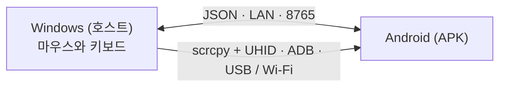

# EzAcrossControl


**연결하고. 제어하고. 이어가세요.** · by ElementZero

읽기: [Português](../../README.md) · [English](README.en.md) · [Español](README.es.md) · [日本語](README.ja.md) · [Italiano](README.it.md) · [Français](README.fr.md) · [Deutsch](README.de.md) · [简体中文](README.zh-CN.md) · [Tiếng Việt](README.vi.md) · **[한국어](README.ko.md)** · [العربية](README.ar.md)

🌐 **웹사이트:** [eddesignerez.github.io/EzAcrossControl](https://eddesignerez.github.io/EzAcrossControl/) · ⬇️ **현재 버전:** [1.1.27](https://github.com/eddesignerez/EzAcrossControl/releases/tag/v1.1.27)

Windows PC의 마우스와 키보드로 Android 태블릿이나 휴대폰을 두 번째 모니터처럼 제어하세요. 선택한 화면 가장자리로 포인터를 옮기면 제어가 Android로 넘어가고, 같은 가장자리를 다시 넘거나 **Esc**를 누르면 Windows로 돌아옵니다. 모든 동작은 로컬 네트워크 안에서 이루어지며 계정, 가입, 클라우드 서비스가 필요 없습니다.

## 이런 분께 추천합니다

- PC 옆에 Android 태블릿을 두고 마우스와 키보드 하나로 두 기기를 모두 쓰고 싶은 분.
- 실물 키보드로 휴대폰에 입력하거나, 책상에서 손을 떼지 않고 메시지에 답하고 Android 앱을 쓰고 싶은 분.
- 데이터를 외부 서버로 보내지 않는 로컬 솔루션을 선호하는 분.

## 주요 기능

| 기능 | 작동 방식 |
| --- | --- |
| **가장자리 전환** | Android가 모니터의 왼쪽에 있는지 오른쪽에 있는지 선택합니다. 포인터가 가장자리를 넘으면 Android를 제어합니다. |
| **네이티브 마우스와 키보드** | 제어 엔진은 UHID로 [scrcpy](https://github.com/Genymobile/scrcpy)를 통합합니다. Android는 이를 실물 마우스와 키보드로 인식하며 스크롤, 클릭, 단축키를 지원합니다. |
| **USB 또는 Wi‑Fi** | 케이블 또는 무선 디버깅으로 연결합니다. **자동** 모드에서는 USB가 우선이며, 케이블을 쓸 수 없으면 Wi‑Fi로 전환됩니다. |
| **로컬 네트워크 전용** | Windows와 Android가 LAN에서 직접 통신합니다(기본 포트 **8765**, 변경 가능). 중계 서버가 없습니다. |
| **올인원 설치 프로그램** | Windows 설치 프로그램에 .NET, ADB, 제어 엔진이 포함되어 있습니다. SDK나 개발 도구를 설치할 필요가 없습니다. |
| **안전한 업데이트** | 두 앱 모두 GitHub의 최신 안정 버전을 확인해 업데이트를 제안하고, 동의한 경우에만 다운로드하며 SHA‑256을 검증합니다. |
| **트레이와 자동 시작** | Windows 앱은 시스템 트레이에 상주하며 Windows와 함께 시작할 수 있습니다(선택 사항). |
| **11개 언어, 두 가지 테마** | 11개 언어 UI와 라이트, 다크, 시스템 설정 테마를 지원합니다. |

## 작동 원리



1. Windows 앱이 마우스와 키보드 입력을 받고 선택한 가장자리를 감시합니다.
2. 포인터가 가장자리를 넘으면 네이티브 엔진(scrcpy + UHID)이 USB 또는 Wi‑Fi로 Android에 제어를 넘깁니다.
3. Android 앱은 연결 상태를 표시하고, 포인터가 가장자리를 다시 넘으면 제어를 Windows로 돌려줍니다.
4. 두 앱은 [Protocol/protocol.md](../../Protocol/protocol.md)의 JSON 규약으로 메시지를 주고받습니다.

## 다운로드 및 설치

- [Windows 설치 프로그램 1.1.27 (.exe)](https://github.com/eddesignerez/EzAcrossControl/releases/download/v1.1.27/EZAcrossControl-1.1.27-windows-x64-setup.exe)
- [Android 앱 1.1.27 (.apk)](https://github.com/eddesignerez/EzAcrossControl/releases/download/v1.1.27/EZAcrossControl-1.1.27-android.apk)
- [Windows 포터블 1.1.18 (.zip)](https://github.com/eddesignerez/EzAcrossControl/releases/download/v1.1.18/EZAcrossControl-1.1.18-windows-x64-portable.zip) — 포터블 형식으로 배포된 최신 버전
- [모든 릴리스, 서드파티 소스, 무결성 검증(SHA‑256)](https://github.com/eddesignerez/EzAcrossControl/releases)

### 요구 사항

| 항목 | 필요 조건 |
| --- | --- |
| **Windows** | Windows 10 또는 11, 64비트. 설치 프로그램에 .NET, ADB, 제어 엔진이 포함됩니다. |
| **Android** | Android 7 이상. 네이티브 제어는 기기의 UHID 지원에 따라 달라지며, 일부 제조사 구현은 추가 설정이 필요할 수 있습니다. |
| **네트워크** | 제어 엔진에 USB를 선택한 경우에도 Windows와 Android가 같은 로컬 네트워크에 있어야 합니다. |
| **디버깅** | USB 디버깅 승인, 또는 무선 디버깅 활성화 및 페어링. Android 메뉴에서 무선 디버깅을 사용하려면 Android 11 이상이 필요합니다. |

### 처음 사용하기

1. Windows 설치 프로그램을 실행하고 **EzAcrossControl**을 엽니다. 로컬 서버와 개인 네트워크 방화벽을 구성하기 위해 관리자 권한을 요청합니다.
2. Android에 APK를 설치합니다. 시스템에서 요청하면 파일을 연 앱의 설치 권한을 허용하세요.
3. **고급 모드 → 디버깅 → 설정 열기**에서 개발자 옵션과 원하는 디버깅 방식을 활성화합니다. Android가 물으면 컴퓨터를 승인하세요.
4. Wi‑Fi를 사용할 경우 **무선 디버깅 → 페어링 코드로 기기 페어링**을 엽니다. 컴퓨터에서 앱에 포함된 ADB를 실행합니다:

   ```powershell
   & "$env:ProgramFiles\EZ Across Control\scrcpy\adb.exe" pair <Android-IP>:<페어링-포트>
   ```

   Android에 표시된 코드를 입력합니다. 페어링 포트와 연결 포트는 서로 다릅니다. 자동 검색으로 기기를 찾지 못하면 `adb connect <Android-IP>:<연결-포트>`를 사용하세요.

5. APK에서 **연결 모드**를 선택합니다: **자동**, **Wi‑Fi**, **USB**(아래 표 참고).
6. **호스트 PC**에 Windows에 표시된 IP를 입력하고 두 앱에 같은 포트를 설정합니다. 기본 포트는 **8765**입니다.
7. 원형 **연결** 버튼을 누릅니다. Wi‑Fi 또는 USB로 제어할 수 있게 되면 앱이 알려 줍니다. Windows에서 Android의 위치를 선택하고 해당 가장자리로 포인터를 옮겨 제어를 전환하세요.

### 연결 모드

Windows와 Android에서 각각 모드를 선택합니다. 양쪽이 서로 맞아야 합니다:

| Windows ↓ / Android → | 자동 | Wi‑Fi | USB |
| --- | --- | --- | --- |
| **자동** | USB, 불가 시 Wi‑Fi | Wi‑Fi | USB |
| **Wi‑Fi** | Wi‑Fi | Wi‑Fi | ❌ 차단 |
| **USB** | USB | ❌ 차단 | USB |

한쪽만 수동 모드이면 그 모드가 사용됩니다. 수동 모드가 서로 다르면 연결이 차단되므로 선택을 맞추거나 자동을 선택하세요. 수동 USB 모드는 Wi‑Fi로 대체되지 않습니다. 선택 항목은 유지되며, 전송 필드에 현재 연결이 표시됩니다.

## 제어, 키보드, 설정

- **화면 전환:** 선택한 가장자리로 포인터를 옮깁니다. Windows로 돌아가려면 같은 가장자리를 반대 방향으로 넘거나 **Esc**를 누르세요.
- **접근성**은 원격 제어와 가장자리 복귀를 돕습니다. 사용자가 Android 메뉴에서 직접 활성화합니다.
- **원격 키보드**는 보조 키보드가 활성화되어 선택되었는지 보여 줍니다. 네이티브 엔진은 HID 키보드도 사용하므로, 필요하면 Android의 실물 키보드 옵션에서 언어/레이아웃을 설정하세요.
- **제어 중지**는 원격 제어를 해제하고 APK 연결을 종료합니다. 새 세션을 시작하려면 연결을 다시 누르세요.
- Windows의 **X** 버튼을 누르면 앱이 트레이로 이동합니다. **복원**으로 다시 열고 **종료**로 닫습니다.
- **Windows와 함께 시작**(언어 아래)을 켜면 Windows 로그인 시 앱이 열립니다. 선택 사항이며 현재 사용자에게만 적용되고, 체크를 해제하면 제거됩니다.
- 해/달 아이콘으로 테마를 전환합니다. **진단**과 **활동 로그**는 고급 모드에 있습니다.

## 업데이트

앱을 열면 Windows와 Android가 이 저장소에 게시된 최신 안정 버전을 확인합니다. **지금 업데이트** 또는 **나중에**를 선택할 수 있으며, 동의 없이 다운로드나 설치가 진행되지 않습니다. 패키지는 이름, 버전, 주소가 정확히 일치하고 크기가 제한되며 GitHub가 제공한 SHA‑256과 일치해야 합니다. Windows에서는 설치 프로그램이 설정을 유지하고 완료 후 앱을 다시 엽니다. 인터넷이 없으면 확인만 실패하고 로컬 네트워크 제어에는 영향이 없습니다. 자세한 내용(포르투갈어)은 [Docs/automatic-updates.md](../automatic-updates.md)를 참고하세요.

## 개인정보와 네트워크

- 기기 간 제어와 메시지는 로컬 네트워크 안에만 머뭅니다. 계정, 원격 측정, 클라우드 경유가 없습니다.
- 인터넷 통신은 GitHub에서의 선택적 업데이트 확인뿐입니다.
- 설치 프로그램이 만드는 방화벽 규칙은 선택한 포트의 TCP만, 개인 네트워크와 로컬 서브넷에서만 허용합니다.

## 언어

Português, English, Español, 日本語, Italiano, Français, Deutsch, 简体中文, Tiếng Việt, 한국어, العربية.

Android는 기본적으로 시스템 언어를 따릅니다. 변경하려면 디버깅 아래의 **고급 모드 → 언어**를 여세요. Windows에서는 진단 섹션에 언어 선택기가 있습니다. 선택은 로컬에 저장됩니다.

## 문제 해결

- **디버깅이 꺼져 있거나 기기가 승인되지 않음:** APK가 안내하는 설정을 열고 옵션을 켠 뒤 컴퓨터를 승인하세요.
- **Wi‑Fi 연결 끊김:** 무선 디버깅과 현재 포트를 확인하세요. 옵션을 껐다 켜면 Android가 포트를 바꿀 수 있습니다. 앱은 열려 있는 동안 제어 가능 상태를 갱신합니다.
- **서버에 연결할 수 없음:** IP, 포트, 그리고 Windows 네트워크가 개인 네트워크로 설정되어 있는지 확인하세요. 설치 프로그램의 규칙은 개인 로컬 네트워크만 허용합니다.
- **연결 차단됨:** Windows와 Android의 수동 모드가 다릅니다. 양쪽을 같은 모드로 맞추거나 자동을 사용하세요.
- **8765 이외의 포트:** 서버를 중지하고 포트를 바꾼 뒤 다시 시작하세요. URL 예약이나 방화벽 규칙을 조정해야 하면 앱이 Windows 권한을 요청합니다. 포트는 정상 시작 후 저장되며, Android에도 같은 값을 설정하세요. 1.1.0 버전에서는 사용자 지정 포트에 수동 설정이 필요합니다.
- **이전 테스트용 APK:** 배포 버전은 별도의 서명을 사용합니다. 디버그 APK에서 옮기려면 이전 버전을 제거한 뒤 이 버전을 설치하세요. 환경설정은 다시 입력해야 합니다.
- **Windows 포터블:** LAN에서 수신하려면 관리자 권한으로 실행하거나 URL 예약/방화벽을 구성하세요. 설치 버전은 기본 포트를 자동으로 구성합니다.
- **SmartScreen 경고:** Windows 설치 프로그램에는 아직 Authenticode 서명이 없습니다. 실행 전에 릴리스 페이지에서 SHA‑256을 확인하세요.

실기기 테스트는 HiPadPlus와 LAVIE T11에서 진행했습니다. HiPadPlus에서는 기기를 초기화한 뒤에야 Gboard의 축소 바가 다시 표시되었으며, 결과는 Android 상태와 Gboard 버전에 따라 다를 수 있습니다. 다른 제조사와의 호환성은 사용하는 기기에서 확인하세요. APK에는 배포용 서명이 있습니다.

## 시각 미리보기

이 이미지들은 제공된 로고를 바탕으로 만든 **브랜드 아이덴티티 정적 시안**이며, 실행 중인 앱의 스크린샷이 아닙니다.

| Day 시안 | Night 시안 |
| --- | --- |
|  |  |

## 아키텍처와 개발

WPF 호스트(.NET 8)와 Kotlin/Compose 클라이언트는 [Protocol/protocol.md](../../Protocol/protocol.md)의 JSON 규약을 사용합니다. 네이티브 엔진은 입력 캡처와 복귀를 위한 패치를 적용한 scrcpy를 통합합니다. 클라우드 경유는 없습니다. [Docs/architecture.md](../architecture.md)와 [Docs/status.md](../status.md)도 참고하세요.

| 폴더 | 내용 |
| --- | --- |
| `Windows-host/` | Windows 호스트, 트레이, 입력 캡처, 제어 엔진 |
| `Android-client/` | APK, 원형 연결 버튼, 접근성, 보조 키보드 |
| `Localization/` | 11개 언어 공용 카탈로그 |
| `Protocol/` | 앱 간 JSON 규약 |
| `Tests/` | 호스트 테스트 |
| `packaging/` | Windows 설치 프로그램 |
| `scripts/` | 언어 생성, 빌드, 배포용 소스 |
| `patches/` | scrcpy 변경 사항 |
| `site/` | GitHub Pages에 게시되는 프로젝트 웹사이트 |

개발 요구 사항: .NET 8 SDK, Android SDK, JDK 17, 그리고 언어 카탈로그 생성을 위한 Node.js. 엔진 빌드는 [Docs/v2/build-scrcpy-windows.md](../v2/build-scrcpy-windows.md)를 참고하세요.

```powershell
node scripts/build-localization.cjs
dotnet build Windows-host/WindowsHost.csproj
dotnet test Tests/WindowsHost.Tests/WindowsHost.Tests.csproj -c Release
cd Android-client
.\gradlew.bat :app:assembleDebug :app:testDebugUnitTest
```

`build-windows-release.ps1`와 `build-android-release.ps1` 스크립트가 배포 패키지를 생성합니다. 릴리스 APK에는 별도의 키가 필요하며, 스크립트는 키와 비밀번호를 Git에서 제외된 로컬 폴더 `.release-private`에 보관합니다. 향후 업데이트에 서명할 수 있도록 이 폴더를 안전하게 보관하세요. 키, 개인 설정, 로그를 GitHub에 올리지 마세요.

번역은 `Localization/messages.tsv`에 있으며, 수정한 뒤에는 생성기를 실행하세요. 두 플랫폼 모두 프로토콜 값을 바꾸지 않고 이 카탈로그를 사용합니다.

## 서드파티

[THIRD-PARTY-NOTICES.md](../../THIRD-PARTY-NOTICES.md), 설치에 포함된 라이선스, 릴리스의 네이티브 소스 아카이브를 참고하세요. 이 구성 요소들은 각자의 라이선스를 따릅니다.
