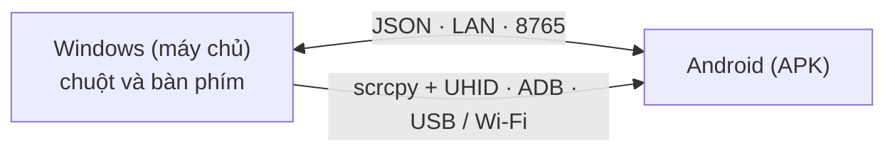

# EzAcrossControl


**Kết nối. Điều khiển. Tiếp tục.** · by ElementZero

Đọc bằng: [Português](../../README.md) · [English](README.en.md) · [Español](README.es.md) · [日本語](README.ja.md) · [Italiano](README.it.md) · [Français](README.fr.md) · [Deutsch](README.de.md) · [简体中文](README.zh-CN.md) · **[Tiếng Việt](README.vi.md)** · [한국어](README.ko.md) · [العربية](README.ar.md)

🌐 **Trang web:** [eddesignerez.github.io/EzAcrossControl](https://eddesignerez.github.io/EzAcrossControl/) · ⬇️ **Phiên bản hiện tại:** [1.1.27](https://github.com/eddesignerez/EzAcrossControl/releases/tag/v1.1.27)

Dùng chuột và bàn phím của máy tính Windows để điều khiển máy tính bảng hoặc điện thoại Android, như thể đó là màn hình thứ hai. Đưa con trỏ tới cạnh màn hình đã chọn, quyền điều khiển chuyển sang Android; đi ngược lại qua cùng cạnh đó (hoặc nhấn **Esc**), quyền điều khiển trở về Windows. Mọi thứ diễn ra trong mạng cục bộ của bạn, không cần tài khoản, không cần đăng ký và không dùng dịch vụ đám mây.

## Dành cho ai

- Người đặt máy tính bảng Android cạnh PC và muốn dùng một bộ chuột và bàn phím cho cả hai.
- Người muốn gõ trên điện thoại bằng bàn phím vật lý, trả lời tin nhắn hoặc dùng ứng dụng Android mà không rời bàn làm việc.
- Người ưu tiên giải pháp cục bộ, không gửi dữ liệu tới máy chủ của bên thứ ba.

## Tính năng

| Tính năng | Cách hoạt động |
| --- | --- |
| **Chuyển qua cạnh màn hình** | Chọn Android nằm bên trái hay bên phải màn hình. Con trỏ đi qua cạnh và bắt đầu điều khiển Android. |
| **Chuột và bàn phím gốc** | Bộ máy điều khiển tích hợp [scrcpy](https://github.com/Genymobile/scrcpy) với UHID: Android nhận diện như chuột và bàn phím vật lý, hỗ trợ cuộn, nhấp và phím tắt. |
| **USB hoặc Wi‑Fi** | Kết nối bằng cáp hoặc gỡ lỗi không dây. Ở chế độ **Tự Động**, USB được ưu tiên và Wi‑Fi sẽ thay thế khi không có cáp. |
| **Chỉ mạng cục bộ** | Windows và Android giao tiếp trực tiếp qua LAN (cổng mặc định **8765**, có thể thay đổi). Không có máy chủ trung gian. |
| **Bộ cài đặt đầy đủ** | Bộ cài đặt Windows đã có sẵn .NET, ADB và bộ máy điều khiển. Không cần cài SDK hay công cụ phát triển. |
| **Cập nhật an toàn** | Cả hai ứng dụng kiểm tra phiên bản ổn định mới nhất trên GitHub, đề xuất cập nhật và chỉ tải xuống khi bạn đồng ý, có xác minh SHA‑256. |
| **Khay hệ thống và tự khởi động** | Ứng dụng Windows nằm ở khay hệ thống và có thể khởi động cùng Windows (tùy chọn). |
| **11 ngôn ngữ, hai giao diện** | Giao diện 11 ngôn ngữ, với chủ đề sáng, tối hoặc theo hệ thống. |

## Cách hoạt động



1. Ứng dụng Windows ghi nhận chuột, bàn phím và theo dõi cạnh màn hình đã chọn.
2. Khi con trỏ vượt qua cạnh, bộ máy gốc (scrcpy + UHID) chuyển quyền điều khiển sang Android qua USB hoặc Wi‑Fi.
3. Ứng dụng Android hiển thị trạng thái kết nối và trả lại quyền điều khiển khi con trỏ quay lại qua cạnh.
4. Hai ứng dụng trao đổi thông điệp theo giao thức JSON trong [Protocol/protocol.md](../../Protocol/protocol.md).

## Tải xuống và cài đặt

- [Bộ cài đặt Windows 1.1.27 (.exe)](https://github.com/eddesignerez/EzAcrossControl/releases/download/v1.1.27/EZAcrossControl-1.1.27-windows-x64-setup.exe)
- [Ứng dụng Android 1.1.27 (.apk)](https://github.com/eddesignerez/EzAcrossControl/releases/download/v1.1.27/EZAcrossControl-1.1.27-android.apk)
- [Windows di động 1.1.18 (.zip)](https://github.com/eddesignerez/EzAcrossControl/releases/download/v1.1.18/EZAcrossControl-1.1.18-windows-x64-portable.zip) — phiên bản di động mới nhất đã phát hành
- [Tất cả phiên bản, mã nguồn bên thứ ba và kiểm tra toàn vẹn (SHA‑256)](https://github.com/eddesignerez/EzAcrossControl/releases)

### Yêu cầu

| Hạng mục | Yêu cầu |
| --- | --- |
| **Windows** | Windows 10 hoặc 11, 64 bit. Bộ cài đặt có sẵn .NET, ADB và bộ máy điều khiển. |
| **Android** | Android 7 trở lên. Điều khiển gốc phụ thuộc vào hỗ trợ UHID của thiết bị; một số nhà sản xuất có thể cần thiết lập thêm. |
| **Mạng** | Windows và Android cùng một mạng cục bộ, kể cả khi chọn USB cho bộ máy điều khiển. |
| **Gỡ lỗi** | Đã cho phép gỡ lỗi USB, hoặc đã bật và ghép nối gỡ lỗi không dây. Gỡ lỗi không dây từ menu Android yêu cầu Android 11 trở lên. |

### Sử dụng lần đầu

1. Chạy bộ cài đặt Windows và mở **EzAcrossControl**. Quá trình cài đặt yêu cầu quyền quản trị để cấu hình máy chủ cục bộ và tường lửa mạng riêng.
2. Cài APK trên Android. Nếu hệ thống hỏi, hãy cho phép cài đặt từ ứng dụng bạn dùng để mở tệp.
3. Trong **Chế Độ Nâng Cao → Gỡ Lỗi → Mở Cài Đặt**, bật tùy chọn nhà phát triển và phương thức gỡ lỗi mong muốn. Cho phép máy tính khi Android hỏi.
4. Với Wi‑Fi, mở **Gỡ lỗi không dây → Ghép nối thiết bị bằng mã ghép nối**. Trên máy tính, chạy ADB đi kèm ứng dụng:

   ```powershell
   & "$env:ProgramFiles\EZ Across Control\scrcpy\adb.exe" pair <IP-Android>:<cổng-ghép-nối>
   ```

   Nhập mã mà Android hiển thị. Cổng ghép nối và cổng kết nối là khác nhau. Nếu tính năng tự động phát hiện không tìm thấy thiết bị, dùng `adb connect <IP-Android>:<cổng-kết-nối>`.

5. Trong APK, chọn **Chế Độ Kết Nối**: **Tự Động**, **Wi‑Fi** hoặc **USB** (xem bảng bên dưới).
6. Trong **Máy Tính Chủ**, nhập IP hiển thị trên Windows và cùng một cổng ở cả hai ứng dụng. Cổng mặc định là **8765**.
7. Chạm vào vòng tròn **Kết Nối**. Ứng dụng sẽ báo khi có thể điều khiển qua Wi‑Fi hoặc USB. Chọn vị trí của Android trong Windows và đưa con trỏ tới cạnh đó để chuyển quyền điều khiển.

### Chế độ kết nối

Chọn chế độ trên Windows và trên Android. Hai bên phải khớp nhau:

| Windows ↓ / Android → | Tự Động | Wi‑Fi | USB |
| --- | --- | --- | --- |
| **Tự Động** | USB; nếu không có thì Wi‑Fi | Wi‑Fi | USB |
| **Wi‑Fi** | Wi‑Fi | Wi‑Fi | ❌ Bị chặn |
| **USB** | USB | ❌ Bị chặn | USB |

Nếu chỉ một bên ở chế độ thủ công, chế độ đó sẽ được dùng. Hai chế độ thủ công khác nhau sẽ chặn kết nối; hãy chọn giống nhau hoặc chọn Tự Động. Chế độ USB thủ công không chuyển sang Wi‑Fi. Bộ chọn giữ nguyên lựa chọn của bạn và trường truyền tải hiển thị kết nối đang hoạt động.

## Điều khiển, bàn phím và cài đặt

- **Chuyển màn hình:** đưa con trỏ tới cạnh đã chọn. Để về Windows, đi ngược qua cùng cạnh đó hoặc nhấn **Esc**.
- **Hỗ Trợ Tiếp Cận** hỗ trợ điều khiển từ xa và việc quay lại qua cạnh. Người dùng tự bật trong menu Android.
- **Bàn Phím Từ Xa** cho biết bàn phím phụ trợ đã được bật và chọn hay chưa. Bộ máy gốc cũng dùng bàn phím HID; khi cần, hãy đặt ngôn ngữ/bố cục trong tùy chọn bàn phím vật lý của Android.
- **Dừng Điều Khiển** giải phóng quyền điều khiển từ xa và đóng kết nối của APK. Chạm Kết Nối lần nữa để bắt đầu phiên mới.
- Nút **X** trên Windows đưa ứng dụng xuống khay hệ thống. Dùng **Khôi Phục** để mở lại và **Thoát** để đóng.
- **Khởi động cùng Windows** (bên dưới mục ngôn ngữ) mở ứng dụng khi bạn đăng nhập Windows. Tùy chọn này không bắt buộc, chỉ áp dụng cho người dùng hiện tại và được gỡ bỏ khi bỏ chọn.
- Biểu tượng mặt trời/mặt trăng chuyển đổi giao diện. **Chẩn Đoán** và **Nhật Ký Hoạt Động** nằm trong chế độ nâng cao.

## Cập nhật

Khi mở, Windows và Android kiểm tra phiên bản ổn định mới nhất được phát hành trong kho này. Bạn chọn **Cập nhật ngay** hoặc **Để sau**; không có gì được tải xuống hay cài đặt nếu bạn không đồng ý. Gói cập nhật phải đúng tên, phiên bản và địa chỉ, có kích thước giới hạn và khớp SHA‑256 do GitHub cung cấp. Trên Windows, bộ cài đặt giữ nguyên cài đặt và mở lại ứng dụng khi hoàn tất. Khi không có internet, việc kiểm tra thất bại mà không ảnh hưởng tới điều khiển qua mạng cục bộ. Chi tiết (tiếng Bồ Đào Nha) tại [Docs/automatic-updates.md](../automatic-updates.md).

## Quyền riêng tư và mạng

- Điều khiển và thông điệp giữa các thiết bị chỉ nằm trong mạng cục bộ. Không tài khoản, không thu thập dữ liệu sử dụng, không định tuyến qua đám mây.
- Giao tiếp internet duy nhất là việc kiểm tra cập nhật tùy chọn trên GitHub.
- Quy tắc tường lửa do bộ cài đặt tạo chỉ cho phép TCP trên cổng đã chọn, trong mạng riêng và mạng con cục bộ.

## Ngôn ngữ

Português, English, Español, 日本語, Italiano, Français, Deutsch, 简体中文, Tiếng Việt, 한국어 và العربية.

Theo mặc định, Android dùng ngôn ngữ của hệ thống. Để đổi, mở **Chế Độ Nâng Cao → Ngôn Ngữ**, bên dưới mục gỡ lỗi. Trên Windows, bộ chọn nằm trong phần chẩn đoán. Lựa chọn được lưu cục bộ.

## Khắc phục sự cố

- **Gỡ lỗi bị tắt hoặc thiết bị chưa được cho phép:** mở phần cài đặt mà APK chỉ dẫn, bật tùy chọn và cho phép máy tính.
- **Mất kết nối Wi‑Fi:** kiểm tra gỡ lỗi không dây và cổng hiện tại; Android có thể đổi cổng sau khi tắt/bật tùy chọn này. Ứng dụng cập nhật trạng thái điều khiển khi đang mở.
- **Không truy cập được máy chủ:** kiểm tra IP, cổng và mạng Windows đã được đặt là mạng riêng. Quy tắc của bộ cài đặt chỉ cho phép mạng cục bộ riêng.
- **Kết nối bị chặn:** chế độ thủ công của Windows và Android khác nhau. Chọn cùng một chế độ ở cả hai bên hoặc dùng Tự Động.
- **Cổng khác 8765:** dừng máy chủ, đổi cổng rồi khởi động lại. Ứng dụng sẽ xin quyền Windows nếu cần điều chỉnh đặt trước URL hoặc quy tắc tường lửa. Cổng được lưu sau khi khởi động thành công; hãy đặt cùng giá trị trên Android. Ở phiên bản 1.1.0, cổng tùy chỉnh cần cấu hình thủ công.
- **APK thử nghiệm cũ:** bản phát hành dùng chữ ký riêng. Để chuyển từ APK gỡ lỗi, hãy gỡ bản cũ rồi cài bản này. Bạn sẽ cần nhập lại các tùy chọn.
- **Windows di động:** chạy với quyền quản trị để lắng nghe trên LAN, hoặc cấu hình đặt trước URL/tường lửa. Bản cài đặt tự cấu hình cổng mặc định.
- **Cảnh báo SmartScreen:** bộ cài đặt Windows chưa có chữ ký Authenticode. Hãy kiểm tra SHA‑256 trên trang phát hành trước khi chạy.

Thử nghiệm thực tế được thực hiện trên HiPadPlus và LAVIE T11. Trên HiPadPlus, Gboard chỉ hiển thị lại thanh thu gọn sau khi khôi phục thiết bị; kết quả có thể phụ thuộc vào trạng thái Android và phiên bản Gboard. Khả năng tương thích với nhà sản xuất khác cần được kiểm tra trên thiết bị bạn dùng. APK có chữ ký phát hành.

## Xem trước hình ảnh

Những hình này là **các phương án tĩnh cho nhận diện thương hiệu**, được tạo từ logo đã cung cấp. Đây không phải ảnh chụp ứng dụng đang chạy.

| Phương án Day | Phương án Night |
| --- | --- |
|  |  |

## Kiến trúc và phát triển

Máy chủ WPF (.NET 8) và ứng dụng Kotlin/Compose dùng giao thức JSON trong [Protocol/protocol.md](../../Protocol/protocol.md). Bộ máy gốc tích hợp scrcpy cùng bản vá cho việc ghi nhận và trả lại đầu vào. Không định tuyến qua đám mây. Xem thêm [Docs/architecture.md](../architecture.md) và [Docs/status.md](../status.md).

| Thư mục | Nội dung |
| --- | --- |
| `Windows-host/` | Máy chủ Windows, khay hệ thống, ghi nhận đầu vào và bộ máy điều khiển |
| `Android-client/` | APK, nút kết nối hình tròn, hỗ trợ tiếp cận và bàn phím phụ trợ |
| `Localization/` | Danh mục dùng chung cho 11 ngôn ngữ |
| `Protocol/` | Giao thức JSON giữa các ứng dụng |
| `Tests/` | Kiểm thử máy chủ |
| `packaging/` | Bộ cài đặt Windows |
| `scripts/` | Tạo ngôn ngữ, build và mã nguồn phát hành |
| `patches/` | Thay đổi đối với scrcpy |
| `site/` | Trang web dự án trên GitHub Pages |

Yêu cầu phát triển: .NET 8 SDK, Android SDK, JDK 17 và Node.js để tạo danh mục ngôn ngữ. Để build bộ máy, xem [Docs/v2/build-scrcpy-windows.md](../v2/build-scrcpy-windows.md).

```powershell
node scripts/build-localization.cjs
dotnet build Windows-host/WindowsHost.csproj
dotnet test Tests/WindowsHost.Tests/WindowsHost.Tests.csproj -c Release
cd Android-client
.\gradlew.bat :app:assembleDebug :app:testDebugUnitTest
```

Các script `build-windows-release.ps1` và `build-android-release.ps1` tạo gói phát hành. APK phát hành cần khóa riêng; script lưu khóa và mật khẩu trong thư mục cục bộ bị bỏ qua `.release-private`. Hãy bảo quản thư mục này an toàn để ký các bản cập nhật sau. Không bao giờ đưa khóa, tùy chọn cá nhân hoặc nhật ký lên GitHub.

Bản dịch nằm trong `Localization/messages.tsv`; chạy trình tạo sau khi chỉnh sửa. Cả hai nền tảng dùng danh mục này mà không thay đổi giá trị của giao thức.

## Bên thứ ba

Xem [THIRD-PARTY-NOTICES.md](../../THIRD-PARTY-NOTICES.md), các giấy phép đi kèm bản cài đặt và kho lưu trữ mã nguồn gốc của bản phát hành. Các thành phần này giữ nguyên giấy phép riêng.
