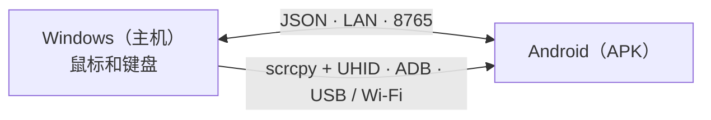

# EzAcrossControl


**连接。控制。继续。** · by ElementZero

阅读语言：[Português](../../README.md) · [English](README.en.md) · [Español](README.es.md) · [日本語](README.ja.md) · [Italiano](README.it.md) · [Français](README.fr.md) · [Deutsch](README.de.md) · **[简体中文](README.zh-CN.md)** · [Tiếng Việt](README.vi.md) · [한국어](README.ko.md) · [العربية](README.ar.md)

🌐 **网站：**[eddesignerez.github.io/EzAcrossControl](https://eddesignerez.github.io/EzAcrossControl/) · ⬇️ **当前版本：**[1.1.27](https://github.com/eddesignerez/EzAcrossControl/releases/tag/v1.1.27)

用 Windows 电脑的鼠标和键盘控制 Android 平板或手机，就像使用第二台显示器一样。把指针移到所选的屏幕边缘，控制权就会切换到 Android；从同一边缘移回（或按 **Esc**），控制权就回到 Windows。一切都在本地网络中完成，无需账号、无需注册，也不使用云服务。

## 适合谁使用

- 在电脑旁放着 Android 平板，希望用一套鼠标和键盘同时操作两台设备的人。
- 想用实体键盘在手机上打字、回复消息或使用 Android 应用，而不必离开办公桌的人。
- 更喜欢本地方案、不希望数据发送到第三方服务器的人。

## 功能

| 功能 | 工作方式 |
| --- | --- |
| **屏幕边缘切换** | 选择 Android 位于显示器左侧还是右侧。指针越过边缘后即开始控制 Android。 |
| **原生鼠标和键盘** | 控制引擎通过 UHID 集成了 [scrcpy](https://github.com/Genymobile/scrcpy)：Android 会识别为实体鼠标和键盘，支持滚动、点击和快捷键。 |
| **USB 或 Wi‑Fi** | 可通过数据线或无线调试连接。在**自动**模式下优先使用 USB，数据线不可用时自动改用 Wi‑Fi。 |
| **仅限本地网络** | Windows 与 Android 通过局域网直接通信（默认端口 **8765**，可配置），没有中转服务器。 |
| **一体化安装程序** | Windows 安装程序已包含 .NET、ADB 和控制引擎，无需安装 SDK 或开发工具。 |
| **安全更新** | 两个应用都会检查 GitHub 上的最新稳定版，提示更新，并且只有在你同意后才下载，同时校验 SHA‑256。 |
| **托盘与开机启动** | Windows 应用驻留在系统托盘，并可选择随 Windows 启动。 |
| **11 种语言和两种主题** | 界面支持 11 种语言，可选浅色、深色或跟随系统主题。 |

## 工作原理



1. Windows 应用捕获鼠标和键盘，并监测所选的屏幕边缘。
2. 当指针越过边缘时，原生引擎（scrcpy + UHID）通过 USB 或 Wi‑Fi 将控制权交给 Android。
3. Android 应用显示连接状态，当指针越过边缘返回时把控制权交还给 Windows。
4. 两个应用使用 [Protocol/protocol.md](../../Protocol/protocol.md) 中的 JSON 协议交换消息。

## 下载与安装

- [Windows 安装程序 1.1.27（.exe）](https://github.com/eddesignerez/EzAcrossControl/releases/download/v1.1.27/EZAcrossControl-1.1.27-windows-x64-setup.exe)
- [Android 应用 1.1.27（.apk）](https://github.com/eddesignerez/EzAcrossControl/releases/download/v1.1.27/EZAcrossControl-1.1.27-android.apk)
- [Windows 便携版 1.1.18（.zip）](https://github.com/eddesignerez/EzAcrossControl/releases/download/v1.1.18/EZAcrossControl-1.1.18-windows-x64-portable.zip) —— 最新发布的便携版
- [所有版本、第三方源码和完整性校验（SHA‑256）](https://github.com/eddesignerez/EzAcrossControl/releases)

### 系统要求

| 项目 | 要求 |
| --- | --- |
| **Windows** | Windows 10 或 11，64 位。安装程序包含 .NET、ADB 和控制引擎。 |
| **Android** | Android 7 或更高版本。原生控制取决于设备的 UHID 支持；部分厂商实现可能需要额外设置。 |
| **网络** | Windows 与 Android 处于同一本地网络，即使控制引擎选择了 USB 也是如此。 |
| **调试** | 已授权的 USB 调试，或已启用并配对的无线调试。通过 Android 菜单使用无线调试需要 Android 11 或更高版本。 |

### 首次使用

1. 运行 Windows 安装程序并打开 **EzAcrossControl**。安装过程会请求管理员权限，用于配置本地服务器和专用网络防火墙。
2. 在 Android 上安装 APK。如果系统询问，请允许用于打开该文件的应用安装应用。
3. 在 **高级模式 → 调试 → 打开设置** 中启用开发者选项和所需的调试方式。Android 询问时授权这台电脑。
4. 使用 Wi‑Fi 时，打开 **无线调试 → 使用配对码配对设备**。在电脑上运行应用自带的 ADB：

   ```powershell
   & "$env:ProgramFiles\EZ Across Control\scrcpy\adb.exe" pair <Android的IP>:<配对端口>
   ```

   输入 Android 显示的配对码。配对端口与连接端口不同。如果自动发现找不到设备，请使用 `adb connect <Android的IP>:<连接端口>`。

5. 在 APK 中选择 **连接模式**：**自动**、**Wi‑Fi** 或 **USB**（见下表）。
6. 在 **主机电脑** 中输入 Windows 上显示的 IP，并在两个应用中设置相同端口。默认端口为 **8765**。
7. 点击圆形 **连接** 按钮。应用会提示何时可以通过 Wi‑Fi 或 USB 进行控制。在 Windows 中选择 Android 所在位置，然后把指针移到该边缘即可切换控制。

### 连接模式

在 Windows 和 Android 上分别选择模式，两边需要匹配：

| Windows ↓ / Android → | 自动 | Wi‑Fi | USB |
| --- | --- | --- | --- |
| **自动** | USB；不可用时 Wi‑Fi | Wi‑Fi | USB |
| **Wi‑Fi** | Wi‑Fi | Wi‑Fi | ❌ 阻止 |
| **USB** | USB | ❌ 阻止 | USB |

如果只有一边为手动模式，则使用该模式。两边手动模式不一致时会阻止连接；请统一选择或改为自动。手动 USB 模式不会回退到 Wi‑Fi。选择器会保留你的选择，传输字段会显示当前连接。

## 控制、键盘与设置

- **切换屏幕：** 把指针移到所选边缘。要回到 Windows，请从同一边缘反向越过，或按 **Esc**。
- **无障碍** 用于辅助远程控制和通过边缘返回，需要用户在 Android 菜单中手动启用。
- **远程键盘** 显示辅助键盘是否已启用并被选中。原生引擎还会使用 HID 键盘；需要时请在 Android 的实体键盘选项中设置语言/布局。
- **停止控制** 会释放远程控制并断开 APK 连接。再次点击“连接”即可开始新会话。
- Windows 上的 **X** 按钮会把应用最小化到托盘。使用 **恢复** 重新打开，使用 **退出** 关闭应用。
- **随Windows启动**（位于语言设置下方）会在登录 Windows 时打开应用。此选项可选，仅对当前用户生效，取消勾选即移除。
- 太阳/月亮图标用于切换主题。**诊断** 和 **活动日志** 位于高级模式中。

## 更新

打开时，Windows 和 Android 会检查本仓库发布的最新稳定版。你可以选择 **立即更新** 或 **稍后**；未经同意不会下载或安装任何内容。安装包必须名称、版本和地址完全匹配，大小受限，并与 GitHub 提供的 SHA‑256 一致。在 Windows 上，安装程序会保留设置并在完成后重新打开应用。没有网络时，仅检查失败，不影响本地网络控制。详细说明（葡萄牙语）见 [Docs/automatic-updates.md](../automatic-updates.md)。

## 隐私与网络

- 设备之间的控制和消息都保留在本地网络中。没有账号、没有遥测，也没有云端路由。
- 唯一的互联网通信是可选的 GitHub 更新检查。
- 安装程序创建的防火墙规则只允许所选端口的 TCP 流量，且仅限专用网络和本地子网。

## 语言

Português、English、Español、日本語、Italiano、Français、Deutsch、简体中文、Tiếng Việt、한국어 和 العربية。

Android 默认跟随系统语言。如需更改，请打开调试下方的 **高级模式 → 语言**。在 Windows 上，语言选择器位于诊断区域。选择会保存在本地。

## 故障排除

- **调试未开启或设备未授权：** 打开 APK 指示的设置，启用相应选项并授权电脑。
- **Wi‑Fi 断开：** 检查无线调试和当前端口；关闭再打开该选项后，Android 可能会更换端口。应用在打开期间会持续更新控制可用状态。
- **无法访问服务器：** 确认 IP、端口，以及 Windows 网络已设为专用网络。安装程序的规则只允许专用本地网络。
- **连接被阻止：** Windows 与 Android 的手动模式不同。请在两边选择相同模式，或使用自动。
- **端口不是 8765：** 停止服务器，修改端口后重新启动。如需调整 URL 保留或防火墙规则，应用会请求 Windows 授权。端口在成功启动后保存；请在 Android 上设置相同的值。在 1.1.0 版本中，自定义端口需要手动配置。
- **旧的测试版 APK：** 正式版使用独立签名。要从调试版 APK 迁移，请先卸载旧版本再安装此版本，之后需要重新填写偏好设置。
- **Windows 便携版：** 以管理员身份运行以在局域网上监听，或手动配置 URL 保留/防火墙。安装版会自动配置默认端口。
- **SmartScreen 警告：** Windows 安装程序尚未进行 Authenticode 签名。运行前请在版本页面核对 SHA‑256。

实机测试在 HiPadPlus 和 LAVIE T11 上进行。在 HiPadPlus 上，Gboard 的精简栏在重置设备后才重新显示；结果可能取决于 Android 状态和 Gboard 版本。与其他厂商设备的兼容性需在实际设备上验证。APK 带有正式发布签名。

## 视觉预览

这些图片是根据提供的标志制作的**品牌视觉静态方案**，并非应用运行时的截图。

| Day 方案 | Night 方案 |
| --- | --- |
|  |  |

## 架构与开发

WPF 主机（.NET 8）和 Kotlin/Compose 客户端使用 [Protocol/protocol.md](../../Protocol/protocol.md) 中的 JSON 协议。原生引擎集成了 scrcpy，并带有用于输入捕获和返回的补丁。没有云端路由。另请参阅 [Docs/architecture.md](../architecture.md) 和 [Docs/status.md](../status.md)。

| 文件夹 | 内容 |
| --- | --- |
| `Windows-host/` | Windows 主机、托盘、输入捕获和控制引擎 |
| `Android-client/` | APK、圆形连接按钮、无障碍服务和辅助键盘 |
| `Localization/` | 11 种语言的共享词库 |
| `Protocol/` | 应用之间的 JSON 协议 |
| `Tests/` | 主机测试 |
| `packaging/` | Windows 安装程序 |
| `scripts/` | 语言生成、构建和发布源码 |
| `patches/` | 对 scrcpy 的修改 |
| `site/` | 发布在 GitHub Pages 上的项目网站 |

开发要求：.NET 8 SDK、Android SDK、JDK 17，以及用于生成语言词库的 Node.js。构建引擎请参阅 [Docs/v2/build-scrcpy-windows.md](../v2/build-scrcpy-windows.md)。

```powershell
node scripts/build-localization.cjs
dotnet build Windows-host/WindowsHost.csproj
dotnet test Tests/WindowsHost.Tests/WindowsHost.Tests.csproj -c Release
cd Android-client
.\gradlew.bat :app:assembleDebug :app:testDebugUnitTest
```

`build-windows-release.ps1` 和 `build-android-release.ps1` 脚本用于生成发布包。正式版 APK 需要独立的签名密钥；脚本会把密钥和密码保存在被忽略的本地文件夹 `.release-private` 中。请妥善保管该文件夹，以便为后续更新签名。切勿把密钥、个人偏好或日志上传到 GitHub。

翻译位于 `Localization/messages.tsv`；修改后请运行生成器。两个平台共用该词库，且不会改变协议中的值。

## 第三方组件

请参阅 [THIRD-PARTY-NOTICES.md](../../THIRD-PARTY-NOTICES.md)、安装包中附带的许可证，以及该版本的原生源码归档。这些组件保留各自的许可证。
