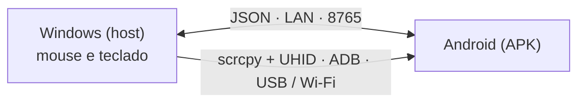
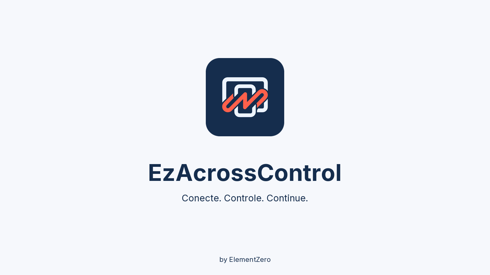
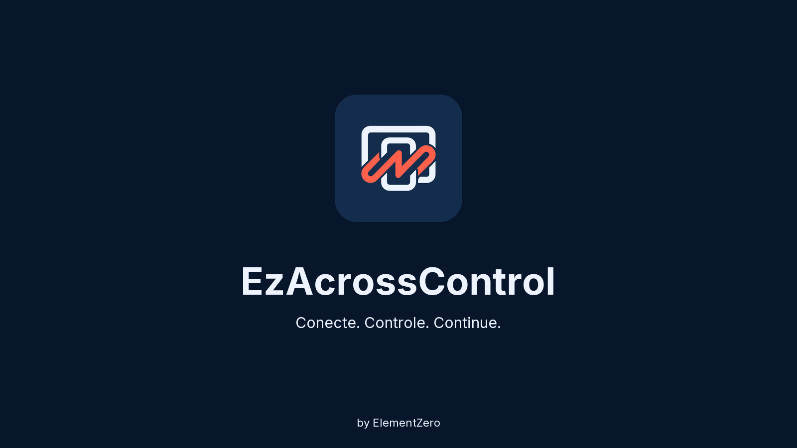
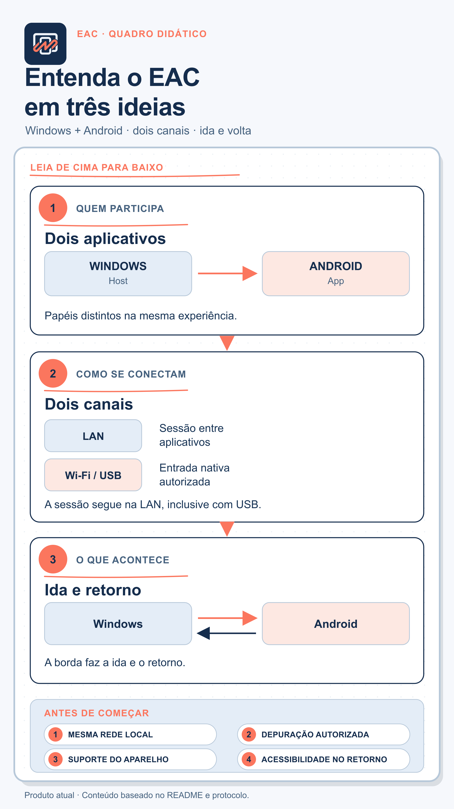

# EzAcrossControl


**Conecte. Controle. Continue.** · by ElementZero

Leia em: **[Português](README.md)** · [English](Docs/i18n/README.en.md) · [Español](Docs/i18n/README.es.md) · [日本語](Docs/i18n/README.ja.md) · [Italiano](Docs/i18n/README.it.md) · [Français](Docs/i18n/README.fr.md) · [Deutsch](Docs/i18n/README.de.md) · [简体中文](Docs/i18n/README.zh-CN.md) · [Tiếng Việt](Docs/i18n/README.vi.md) · [한국어](Docs/i18n/README.ko.md) · [العربية](Docs/i18n/README.ar.md)

🌐 **Site:** [eddesignerez.github.io/EzAcrossControl](https://eddesignerez.github.io/EzAcrossControl/) · ⬇️ **Versão atual:** [1.1.27](https://github.com/eddesignerez/EzAcrossControl/releases/tag/v1.1.27)

Use o mouse e o teclado do seu PC Windows para controlar um tablet ou celular Android, como se fosse um segundo monitor. Leve o ponteiro até a borda escolhida da tela e o controle passa para o Android; volte pela mesma borda (ou pressione **Esc**) e o controle retorna ao Windows. Tudo acontece na sua rede local, sem conta, sem cadastro e sem serviços de nuvem.

## Para quem é

- Quem trabalha com um tablet Android ao lado do PC e quer usar um único mouse e teclado nos dois.
- Quem quer digitar no celular com um teclado físico, responder mensagens ou navegar em apps Android sem tirar as mãos da mesa.
- Quem prefere uma solução local, sem enviar dados para servidores de terceiros.

## Recursos

| Recurso | Como funciona |
| --- | --- |
| **Troca pela borda** | Escolha se o Android fica à esquerda ou à direita do monitor. O ponteiro atravessa a borda e passa a controlar o Android. |
| **Mouse e teclado nativos** | O motor de controle integra o [scrcpy](https://github.com/Genymobile/scrcpy) com UHID: o Android enxerga um mouse e um teclado físicos, com rolagem, cliques e atalhos. |
| **USB ou Wi‑Fi** | Conecte pelo cabo ou pela depuração sem fio. No modo **Auto**, o USB tem prioridade e o Wi‑Fi assume quando o cabo não está disponível. |
| **Somente rede local** | Windows e Android conversam diretamente pela LAN (porta padrão **8765**, configurável). Não há servidor intermediário. |
| **Instalador completo** | O instalador do Windows já traz .NET, ADB e o motor de controle. Não é preciso instalar SDK nem ferramentas de desenvolvedor. |
| **Atualizações seguras** | Os dois aplicativos verificam a última versão estável no GitHub, mostram a oferta e só baixam com o seu aceite, validando o SHA‑256. |
| **Bandeja e início automático** | O aplicativo do Windows fica na bandeja do sistema e pode iniciar junto com o Windows (opcional). |
| **11 idiomas e dois temas** | Interface em 11 idiomas, com tema claro, escuro ou automático pelo sistema. |

## Como funciona



1. O aplicativo do Windows captura o mouse e o teclado e observa a borda escolhida.
2. Quando o ponteiro cruza a borda, o controle é entregue ao Android pelo motor nativo (scrcpy + UHID), por USB ou Wi‑Fi.
3. O APK no Android informa o estado da conexão e devolve o controle quando o ponteiro volta pela borda.
4. Os dois aplicativos trocam mensagens pelo contrato JSON em [Protocol/protocol.md](Protocol/protocol.md).

## Baixar e instalar

- [Instalador Windows 1.1.27 (.exe)](https://github.com/eddesignerez/EzAcrossControl/releases/download/v1.1.27/EZAcrossControl-1.1.27-windows-x64-setup.exe)
- [Aplicativo Android 1.1.27 (.apk)](https://github.com/eddesignerez/EzAcrossControl/releases/download/v1.1.27/EZAcrossControl-1.1.27-android.apk)
- [Windows portátil 1.1.18 (.zip)](https://github.com/eddesignerez/EzAcrossControl/releases/download/v1.1.18/EZAcrossControl-1.1.18-windows-x64-portable.zip) — última versão publicada em formato portátil
- [Todas as versões, fontes de terceiros e verificações de integridade (SHA‑256)](https://github.com/eddesignerez/EzAcrossControl/releases)

### Requisitos

| Item | Necessário |
| --- | --- |
| **Windows** | Windows 10 ou 11, 64 bits. O instalador inclui .NET, ADB e o motor de controle. |
| **Android** | Android 7 ou posterior. O controle nativo depende do suporte UHID do aparelho; algumas implementações de fabricante podem exigir configurações adicionais. |
| **Rede** | Windows e Android na mesma rede local, inclusive quando USB é escolhido para o motor de controle. |
| **Depuração** | Depuração USB autorizada, ou depuração sem fio ativada e pareada. A depuração sem fio pelo menu do Android requer Android 11 ou posterior. |

### Primeiro uso

1. Execute o instalador Windows e abra **EzAcrossControl**. A instalação solicita permissão de administrador para configurar o servidor local e o firewall da rede privada.
2. Instale o APK no Android. Permita a instalação pelo aplicativo usado para abrir o arquivo, caso o sistema solicite.
3. Em **Modo Avançado → Depuração → Abrir Configurações**, ative as opções de desenvolvedor e o método de depuração desejado. Autorize o computador quando o Android perguntar.
4. Para Wi‑Fi, abra **Depuração sem fio → Parear dispositivo com código de pareamento**. No computador, execute o ADB incluído no aplicativo:

   ```powershell
   & "$env:ProgramFiles\EZ Across Control\scrcpy\adb.exe" pair <IP-do-Android>:<porta-de-pareamento>
   ```

   Digite o código exibido pelo Android. A porta de pareamento e a porta de conexão são diferentes. Se a descoberta automática não encontrar o aparelho, use `adb connect <IP-do-Android>:<porta-de-conexão>`.

5. No APK, escolha o **Modo de Conexão**: **Auto**, **Wi‑Fi** ou **USB** (veja a tabela abaixo).
6. Em **Host PC**, informe o IP exibido no Windows e a mesma porta nos dois aplicativos. A porta padrão é **8765**.
7. Toque no círculo **Conectar**. O aplicativo informa quando o controle está disponível por Wi‑Fi ou USB. Escolha a posição do Android no Windows e mova o ponteiro até essa borda para alternar o controle.

### Modos de conexão

Escolha o modo no Windows e no Android. Os dois lados precisam combinar:

| Windows ↓ / Android → | Auto | Wi‑Fi | USB |
| --- | --- | --- | --- |
| **Auto** | USB; se indisponível, Wi‑Fi | Wi‑Fi | USB |
| **Wi‑Fi** | Wi‑Fi | Wi‑Fi | ❌ Bloqueado |
| **USB** | USB | ❌ Bloqueado | USB |

Se apenas um lado estiver em modo manual, esse modo é usado. Modos manuais divergentes bloqueiam a conexão; alinhe as escolhas ou selecione Auto. O modo USB manual não usa Wi‑Fi como alternativa. Os seletores preservam suas escolhas e o campo de transporte informa a conexão ativa.

## Controle, teclado e configurações

- **Troca de tela:** mova o ponteiro até a borda escolhida. Para voltar ao Windows, atravesse a mesma borda no sentido contrário ou pressione **Esc**.
- **Acessibilidade** auxilia o controle remoto e o retorno pela borda. A ativação é feita pelo usuário no menu do Android.
- **Teclado Remoto** informa se o teclado auxiliar está ativado e selecionado. O motor nativo também usa um teclado HID; configure seu idioma/layout nas opções de teclado físico do Android quando necessário.
- **Parar Controle** libera o controle remoto e encerra a conexão do APK. Toque novamente em Conectar para iniciar outra sessão.
- O botão **X** no Windows envia o aplicativo à bandeja. Use **Restaurar** para reabrir e **Sair** para encerrá-lo.
- **Iniciar com Windows** (abaixo do idioma) abre o aplicativo ao entrar no Windows. É opcional, vale só para o usuário atual e é removido ao desmarcar.
- Os ícones de sol/lua alternam os temas. **Diagnóstico** e **Registro de Atividade** ficam no modo avançado.

## Atualizações

Ao abrir, Windows e Android consultam a última versão estável publicada neste repositório. Você escolhe **Atualizar agora** ou **Depois**; nada é baixado ou instalado sem aceite. O pacote precisa ter nome, versão e endereço exatos, tamanho limitado e o SHA‑256 informado pelo GitHub. No Windows, o instalador preserva as configurações e reabre o aplicativo ao concluir. Sem internet, a consulta falha sem afetar o controle pela rede local. Detalhes em [Docs/automatic-updates.md](Docs/automatic-updates.md).

## Privacidade e rede

- O controle e as mensagens entre os aparelhos ficam na rede local. Não há conta, telemetria nem roteamento pela nuvem.
- A única comunicação com a internet é a consulta opcional de atualizações no GitHub.
- A regra de firewall criada pelo instalador permite somente TCP na porta escolhida, em redes privadas e na sub-rede local.

## Idiomas

Português, English, Español, 日本語, Italiano, Français, Deutsch, 简体中文, Tiếng Việt, 한국어 e العربية.

O Android segue o idioma do sistema por padrão. Para alterar, abra **Modo Avançado → Idioma**, abaixo da depuração. No Windows, o seletor fica na seção de diagnóstico. A escolha é salva localmente.

## Solução de problemas

- **Depuração desligada ou dispositivo não autorizado:** abra as configurações indicadas pelo APK, habilite a opção e autorize o computador.
- **Wi‑Fi caiu:** confira a depuração sem fio e a porta atual; o Android pode mudar a porta depois de desligar/ligar essa opção. O aplicativo atualiza a disponibilidade do controle enquanto está aberto.
- **Servidor inacessível:** confirme o IP, a porta e que a rede Windows está marcada como privada. A regra criada pelo instalador permite apenas a rede local privada.
- **Conexão bloqueada:** os modos manuais do Windows e do Android estão diferentes. Escolha o mesmo modo nos dois ou use Auto.
- **Porta diferente de 8765:** pare o servidor, altere a porta e inicie novamente. O aplicativo solicita autorização do Windows se precisar ajustar a reserva de URL ou a regra de firewall. A porta é salva após o início bem-sucedido; configure o mesmo valor no Android. Na versão 1.1.0, portas personalizadas precisam de configuração manual.
- **APK de testes anterior:** a versão de distribuição usa uma assinatura própria. Para migrar de um APK de depuração, desinstale a versão antiga e instale esta. As preferências deverão ser informadas novamente.
- **Windows portátil:** execute como administrador para escutar na LAN ou configure a reserva de URL/firewall. A versão instalável configura a porta padrão.
- **Aviso do SmartScreen:** o instalador Windows ainda não tem assinatura Authenticode. Confira o SHA‑256 na página da versão antes de executar.

Os testes físicos foram realizados em um HiPadPlus e um LAVIE T11. No HiPadPlus, o Gboard só voltou a mostrar a barra reduzida depois de restaurar o aparelho; o resultado pode depender do estado do Android e da versão do Gboard. A compatibilidade com outros fabricantes deve ser verificada no aparelho usado. O APK possui assinatura de distribuição.

## Prévias visuais

Estas imagens são **estudos estáticos da identidade visual**, criados a partir da logo fornecida. Não são capturas do aplicativo em execução.

| Proposta Day | Proposta Night |
| --- | --- |
|  |  |

<a href="Brand/VisualLearningWhiteboard/EzAcrossControl-visual-learning-whiteboard-mobile.png"></a>

[Abrir o quadro visual para celular](Brand/VisualLearningWhiteboard/EzAcrossControl-visual-learning-whiteboard-mobile.png) · [Comparar as variantes da identidade](Brand/Preview/brand-preview.png)

## Arquitetura e desenvolvimento

O host WPF (.NET 8) e o cliente Kotlin/Compose usam o contrato JSON em [Protocol/protocol.md](Protocol/protocol.md). O motor nativo integra scrcpy com um patch para captura e retorno de entrada. Não há roteamento pela nuvem. Veja também [Docs/architecture.md](Docs/architecture.md) e [Docs/status.md](Docs/status.md).

| Pasta | Conteúdo |
| --- | --- |
| `Windows-host/` | Host Windows, bandeja, captura e motor de controle |
| `Android-client/` | APK, conexão circular, acessibilidade e teclado auxiliar |
| `Localization/` | Catálogo compartilhado dos 11 idiomas |
| `Protocol/` | Contrato JSON entre os aplicativos |
| `Tests/` | Testes do host |
| `packaging/` | Instalador Windows |
| `scripts/` | Geração de idiomas, compilações e fontes de distribuição |
| `patches/` | Alterações no scrcpy |
| `site/` | Página do projeto publicada no GitHub Pages |

Requisitos de desenvolvimento: .NET 8 SDK, Android SDK, JDK 17 e Node.js para gerar o catálogo de idiomas. Para compilar o motor, consulte [Docs/v2/build-scrcpy-windows.md](Docs/v2/build-scrcpy-windows.md).

```powershell
node scripts/build-localization.cjs
dotnet build Windows-host/WindowsHost.csproj
dotnet test Tests/WindowsHost.Tests/WindowsHost.Tests.csproj -c Release
cd Android-client
.\gradlew.bat :app:assembleDebug :app:testDebugUnitTest
```

Os scripts `build-windows-release.ps1` e `build-android-release.ps1` geram os pacotes de distribuição. O APK de release precisa de uma chave própria; o script mantém a chave e a senha na pasta local ignorada `.release-private`. Guarde essa pasta com segurança para assinar futuras atualizações. Nunca envie chaves, preferências pessoais ou logs ao GitHub.

As traduções ficam em `Localization/messages.tsv`; execute o gerador depois de alterá-las. O catálogo é consumido pelas duas plataformas sem alterar os valores do protocolo.

A página do projeto fica em `site/index.html` e é publicada automaticamente no GitHub Pages pelo workflow `.github/workflows/pages.yml` a cada alteração em `site/` na branch `main`.

## Terceiros

Consulte [THIRD-PARTY-NOTICES.md](THIRD-PARTY-NOTICES.md), as licenças incluídas na instalação e o arquivo de fontes nativas da release. Esses componentes mantêm suas próprias licenças.
